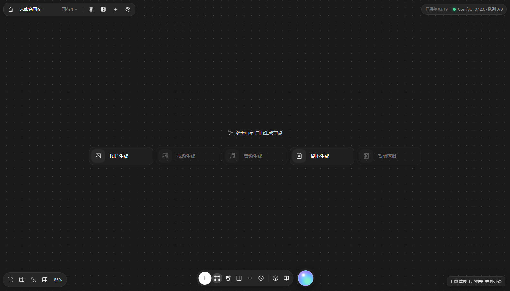
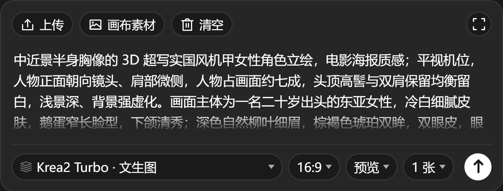

# Comfy 无限画布

一个**零依赖**的本地无限画布，把浏览器里的节点式创作界面直接接到你本机的 ComfyUI（默认 `127.0.0.1:8188`）。
这类节点式创作工具的骨架都是「本地 Node/Python 服务 + Web 画布 + 内置 API 工作流 → 转发给 ComfyUI」。这里用最薄的方式实现它：**一份 Python 标准库服务 + 一份静态前端**，不装任何 npm 包。





## 快速开始

双击 `启动.bat`，或命令行：

打开后先看到**首页**：新建画布 / 快速开始 / 继续上次的画布。

```bash
python server.py                # 默认 127.0.0.1:8788，自动开浏览器
python server.py --port 9000
python server.py --comfy http://127.0.0.1:8188
python server.py --data D:\canvas-data   # 换运行时数据目录（快照 + 工作流库）
python selftest.py              # 接口回归：临时实例 + 42 项断言（需要 ComfyUI），跑完即删
```

要求：Python 3.9+，本机 ComfyUI 已在运行（`system_stats` 可访问）。无需 `pip install`。

## 开发

产品运行时零依赖，但仓库里带了一套开发脚手架（测试 / 图标生成 / 打包）。

```bash
npm install        # 只装开发依赖（@icon-park/svg、prettier）
npm run dev        # 8788 + 不自动开浏览器
npm run check      # 所有 js 语法检查 + py_compile
npm test           # 冒烟（不需要 ComfyUI）
npm run test:e2e   # 浏览器 e2e（Chrome + CDP，不装 playwright）
npm run shots      # 截一套图到 tests/.tmp/shots/，改完 UI 对比用
npm run icons      # 重新生成 static/icons.js
npm run pack       # 打 zip 到 dist/
```

细节见 [`docs/DEVELOPMENT.md`](docs/DEVELOPMENT.md)（环境、脚本、加图标、加接口、提交前检查）
和 [`docs/ARCHITECTURE.md`](docs/ARCHITECTURE.md)（服务端路由、前端分区、快照 schema、CSS 分层、已知债）。

## 它能做什么

| 能力 | 说明 |
|---|---|
| 对齐 / 分布 | 选中 2 个以上节点，**选区上方浮出一条图标工具条**（不用先点按钮再选菜单，上面放不下会自动翻到下方）：**左 / 水平居中 / 右 / 顶 / 垂直居中 / 底**六种对齐 + **水平等距 / 垂直等距**，鼠标悬停有中文提示。对齐按整体包围盒算（不是按第一个选中的节点），整批进撤销栈，`Ctrl+Z` 一次退回 |
| 无限画布 | 拖空白平移、滚轮以光标为中心缩放（15% ~ 800%）、网格随缩放变化（两端都收，免得极小时糊成一片、极大时稀得像噪点）|
| 提示词节点 | 一段文本，连到任意工作流的文本插槽 |
| 图片节点 | 选本地图片自动上传进 ComfyUI 的 `input/`，可直接喂图生图 / 图生视频 |
| 图片节点自带生成器 | **选中图片节点**，下方浮出生成器面板：提示词 + 工作流 + 参数胶囊（画幅 · 清晰度 · 张数）→ 直接出图落进该节点；参数收进一颗胶囊，点开是分组弹层——**13 种画幅按图形网格排**（胖瘦一眼可比），清晰度带长边像素，还能填**自定义宽高**（自动对齐 16，刷新后依然生效），底部实时报最终出图尺寸；这些数字会真的写进工作流的出图节点，不再出现「选的 1280×720、出来 1024×1024」。工作流没有批量插槽时，选多张会明确告诉你「张数不生效」；提交了 4 张却只回来 1 张时，也会说「只回来 1 张（提交了 4 张）」——那是工作流里有节点把批量并成了一路，而不是提交失败 |
| 多图结果 | 一次出好几张时，缩略图左下角直接标 `2 / 4`，两侧常显 `‹ ›` 箭头，下方一排圆点也能点；选中节点时 `←/→` 就是翻页（首尾环回）。点开放大后同样能翻页，自带 `n / N`；右侧抽屉给出这张图的**分辨率 / 来源 / 工作流 / 种子 / 生成次数 / 完整提示词**（所有放大入口都是同一套）。选中的那张就是节点当前的图（再拿它去图生图/参考图用的就是这张），刷新后仍停在你选的那张 |
| 生成历史 | 每生成一次就留一条记录，缩略图**右下角**标「N 次」——和左下角的「1 / 4」正好分工：左边管"这一批里的第几张"，右边管"第几次生成"。点开是**三列宫格**（新→旧，当前那次有白框），**单击任意一张进大图**，右侧抽屉列出**分辨率 / 张数 / 种子 / 工作流 / 时间 / 完整提示词**；卡上两个动作：「换回节点」（把那一批图换回节点）和「派生到新节点」（复制全套参数，种子切固定）。最多留 30 条，旧的自动淘汰 |
| 资产管理 | 顶栏「资产」拉出右侧抽屉：**生成结果 + 上传素材 + 画布上现有的图**全在一个三列方格网里，带来源徽章（画布 / 生成 / 上传）、文件名搜索、按来源筛选（计数按筛选结果算）和刷新。单击看大图（接着往后翻），双击或点右上「＋」直接放进画布（上传素材按文件名引用，不重复上传）。数据来自 `/history` 的**索引**——不扫输出目录、不复制文件，换台机器也不怕 ComfyUI 装在哪 |
| 多连输入口 | 图片/文本节点的左侧输入口**可以同时接多个节点**（多条线汇到一个点），接进来的图按顺序进参考图列表；工作流插槽和图片输出口仍是一对一 |
| 参考图（缩略图 + `@`） | 连进图片节点的图、以及提示词里 `@` 引用的图，都在面板顶部排成缩略图（多张时带 1/2/3 序号，缩略图上方写清「提示词里的『图1』」）；**工作流能吃几张就送几张**（Qwen 编辑流是 `images.image_1..4`），按顺序绑定，吃不下的靠后几张不送；`@` 弹出素材菜单（搜索 + 「已关联 / 全部素材」两页，贴着光标弹），选中后 **提示词里直接出现一枚「小缩略图 + 图名」的内联胶囊**，真身是 `@[图名]` 文本，**提交时改写成语义指向**：`@[甲]` → `图1`、`@[乙]` → `图2`（序号＝实际送去模型的顺序），句子结构保持不变 |
| 参考图顺序 | 画布给的图按 `images.image_N` 里的 N 从小到大填：`@` 的第一个引用 → `image_1`，第二个 → `image_2`。多给或少给都安全：多的不送、少的把剩余槽位断开并删掉孤儿 `LoadImage`（否则本地文件名不在 `input/` 里会 400） |
| 工作流节点 | 载入任意 **API 格式**工作流，自动识别可编辑插槽；参数收在节点里的「设置」弹层，节点本身只显示参数数/连线数、运行与设置 |
| 提交前清理 | 工作流自带的图片（导出者本地的 `023.jpg`、他上次跑出来的 `xxx_00483_.png`）会在提交前被摘掉：同一组 `images.image_1..N` 里只留画布绑定的那几张，其余断开并删掉孤儿 `LoadImage`；状态栏写「忽略自带图 N」 |
| 图片输出节点 | 接收工作流节点的结果输出（右侧圆点 → 左侧圆点），生成完成后结果自动流进来；连了输出节点后，工作流节点内不再重复显示结果 |
| 首页 | 点阵背景的「新建画布创作」+ 快速开始（按工作流一键开局）+ 上次的画布（节点数 / 保存时间）；`#home` / `#canvas` 两个路由 |
| 空画布起始页 | 新建画布后画布中央浮出「双击画布 自由生成节点」+ 五个能力入口（图片/视频/音频/剧本/剪辑），点一下就把对应内容放进画布，有节点后自动收起 |
| 顶部项目栏 | 左：可改名的**项目名** + `画布 1` 菜单（重命名 / 新建 / 删除）+ 工作流、故事板、**资产**入口；右：ComfyUI 运行状态 |
| 底部工具条 | **底部居中**的悬浮胶囊（9 项）：`＋` 添加节点 / **框选（默认高亮）** / 移动（抓手）/ 素材库 / 全部功能 / 生成历史 / 快捷键 / 教程 / 首页（渐变球） |
| 左下视图控制 | 整理画布（适配）/ **小地图**（可点跳转）/ 隐藏连线 / 网格吸附 / 缩放档位 |
| 双击新建 | 画布空白处双击弹出节点菜单，就地建节点 |
| 拖文件入画布 | 拖入 PNG/JPG/WEBP 自动建图片节点并上传进 ComfyUI `input/` |
| 框选 | **拖画布空白处直接框选**（与节点相交即选中），`Shift` 拖为加选；点空白取消选择，松手后提示「已框选 N 个节点」 |
| 打组 | `Shift` 点选加选，`Ctrl/Cmd + G` 打组，组标题上可「执行」整组或「解组」 |
| 插槽自动识别 | 靠 `/object_info` 判断类型：文本 / 种子 / 数值 / 布尔 / 枚举下拉 / 图片；枚举插槽可换模型、换采样器 |
| 结果呈现 | 图片、视频、音频直接显示在节点里，可放大、可「钉到画布」继续当输入 |
| 工作流库 | 内置预设 + 自己存的工作流，存在 `data/library/` |
| 运行记录导入 | 「资产库 → ComfyUI 运行记录」把 `/history` 里的记录排成**宫格**（封面取第一张产物，多图带角标，没有产物的显示占位块）。**单击看大图**，右侧抽屉列出分辨率 / 节点数 / 产物数 / 采样步数 · CFG · 采样器 / 种子 / 尺寸 / 提示词，卡上「用这个工作流」直接把那次执行的 API 图放回画布（这个最省事，见下） |
| 画布持久化 | 自动存 localStorage，退出时同步到 `data/canvas.json`；也能导出/导入 JSON |

## 首页与路由

- `/`（或 `#home`）→ 首页；`#canvas` → 编辑器。首页右上角工具条的房子图标可随时返回。
- **新建画布创作**：清空并进入编辑器（当前画布已自动存本机，会二次确认）。
- **快速开始**：列出内置预设与你的工作流库，点一下即新建画布并自动摆好「提示词 → 工作流 → 图片输出」三节点并连好线。
- **上次的画布**：显示节点数与保存时间，点「进入」直接继续；右侧的**垃圾桶按钮 = 删除这个画布**（连存档一起删，二次确认，删除后本机快照 `data/canvas.json` 与 localStorage 一并清掉）。注意它和编辑器里的「清空」不同：清空只清节点，删除是把这个画布从本机移除。
- 首页也会显示 ComfyUI 版本与队列，连不上时状态点变红。
- **空画布起始页**：点「新建画布创作」进入空白画布后，中央浮出「双击画布 自由生成节点」+ 五个能力入口。起始页容器 `pointer-events: none`（只有按钮可点），所以**双击穿透到画布**仍能就地建节点；画布上一有节点它就自动收起。
- 五个能力入口按你实际拥有的工作流自动启用或置灰：服务端读每个工作流的 API 图，按保存节点类型标出 `kinds`（image / video / audio）。能点就直接把「提示词 → 工作流 → 输出」放到位，没有就置灰并提示去「工作流库 → 运行记录」导入；「剧本生成」不需要模型（放提示词节点）；「智能剪辑」本地暂不具备。

## 节点外观

节点外壳与内容分离：

- **标题在卡片外面**：小图标 + 名称 +（工作流节点有「运行」），删除按钮 hover 才出现，不占卡片空间。
- **卡片本体** `.node-card`：圆角 12、1px 描边，选中时描边变蓝。
- **端口**：卡片左右边沿的圆环，中间一个 `+`；插槽里的输入端口保持小圆点，避免噪音。
- **图片节点空态**：居中大图占位 + 「尝试：」下的「上传图片 / 文本生图」两个入口。
- **可拖拽改大小**：卡片右下角有拉伸手柄（hover 或选中时出现）。文本/工作流节点可改宽度；**图片节点不支持缩放**，宽度固定 380，高度按图片原比例自适应（避免手柄和生成器面板/连线抢事件）。宽度下限 200px，上限 760px，尺寸写进画布存档。
- **生成中的反馈**：点生成后，按钮变成旋转加载环，图片中央盖一层「生成中 42%」遮罩（百分比来自后端 websocket，拿不到就显示「生成中…」），完成后自动消失并显示图片。
- **进度条**：图片节点生成、工作流节点运行时，卡片顶部出现一条细进度条——有真实百分比就按百分比走，拿不到就显示不确定动画，完成/出错后自动收起。百分比来自后端订阅 ComfyUI 的 websocket（浏览器直连会被 ComfyUI 的 Origin 校验挡掉）。
- **顶栏「设置」**（齿轮）：选默认工作流（新建图片节点/工作流节点时用，存 localStorage），或一键打开工作流库。
- **生成器**是卡片下方一块独立面板：顶部 chips（上传 / 画布素材 / 清空 / 展开）、中间**参考图缩略图 + 大输入框**、底部一条控制栏（工作流 · `1:1 · 1K · 1张` 参数胶囊 + 圆形 ↑ 提交），`Ctrl/Cmd + Enter` 也能直接生成。参数胶囊点开是「画幅 / 清晰度 / 张数」三段：画幅用 13 个按真实比例变形的小框排成 5 列网格；清晰度是 **1K / 2K / 4K**，按**长边像素**算（1024 / 2048 / 4096），短边跟着画幅缩——所以 1:1 的 1K 是 1024²、16:9 的 2K 是 2048×1152；下面还有**自定义宽高**两个输入框，敲数字就切到自定义档，比例按宽高反推、网格里那一格跟着亮，值自动对齐 16 的倍数；底部一行实时显示「9:16 · 1152 × 2048 · 2.4MP」，超过 4MP 会追加「本地偏慢」。
- **参考图缩略图**：连线进来的图（含挂在左侧文本节点上的）、`@` 引用的图，都排在这里，序号就是提交时的「图N」。排在前面的先占工作流的图片槽位，工作流吃不下的（比如只有一个图片插槽却给了三张）靠后几张不会送进去；`@` 引用带虚线外框，鼠标移上去点 `✕` 取消。缩略图悬停有来源说明（连线 / 经文本节点 / @ 引用）和「提示词里的『图N』」。
- **`@` 引用素材**：在输入框里打 `@`（**紧跟文案也行**，`雪夜@` 就够，不必先敲空格）弹出素材菜单，贴着光标弹，带搜索框和两个标签页：
  - **已关联**——只列已经连进来的图（连线 / 经文本节点）。没连线时这里是空的，只给一行「浏览画布全部素材」，不会凭空摊一堆图让人以为多出了参考图；
  - **全部素材**——画布上其它所有图片，这就是那个「全局选择」；右侧标来源（连线 / 经文本 / 画布）。
  选中即把那张图变成正文里的一枚**内联胶囊**（小缩略图 + 图名），同时加进参考图。同名的图（生成出来的都叫「图片」）自动补 `#1 #2` 序号，胶囊也按序号精确指回那一张。
  胶囊在正文里就是一个字符：`Backspace` 一下整块删掉、回车也不会把它拆开；删掉胶囊＝取消这张参考图，缩略图跟着消失，反之点缩略图的 `✕` 也会把胶囊从正文里摘掉。它的真身是 `@[图名]` 文本——**提交时改写成「图N」，不是删掉**：删掉会得到「把 的画面放进 的排版里」，模型只能瞎猜；写成「图1 / 图2」才对得上真正送进去的那两张（胶囊的 `title` 会直接告诉你「提交时写作『图1』」）。
- **输入框是 contenteditable**：只有这样才能把图片塞进文字里。对外（存档 / 提交 / 撤销）仍然是一段纯文本，`promptText()` 负责把胶囊还原成 `@[图名]`；回车固定插 `<br>`（默认会包一层 `<div>`，正文混满块级元素后光标和选区都不听话），粘贴只收纯文本。

## 图标与圆角

- **图标全部来自 IconPark**（<https://iconpark.oceanengine.com/official>，字节跳动开源图标库，Apache-2.0）：轮廓主题、48×48 viewBox、`stroke-width: 4`、颜色走 `currentColor`。
  生成好的静态拷贝在 `static/icons.js`（`window.icon(name)` / `<span data-icon="name">`），**不引 CDN、不装依赖**，离线可用。
  换图标：改 `_debug/icons/gen.cjs` 里的「短名 → IconPark 组件名」映射，`node gen.cjs` 重新生成即可。
- **形状**：方形图标按钮一律**正圆**（`border-radius: 50%`，dock 32/38、顶栏 32、视图工具 32、面板展开按钮 24）；带文字的控件和普通按钮一律**胶囊**（`border-radius: 999px`）。
  例外：首页「新建画布创作」大卡、五个能力入口、最近项目卡保持 16~18px 圆角。

## 节点与连线

四类节点、三种端口。文本和图片节点之间**可以随意互连**，工作流插槽仍按类型：

| 节点 | 出端口 | 入端口 |
|---|---|---|
| 提示词 | `text` | `any` |
| 图片 | `image` | `any` |
| 工作流 | `media` | `any`（自动落到第一个空闲的文本/图片插槽） |
| 图片输出 | — | `media` |

```
文本/图片 ──any──► 图片        文本当提示词，图片当参考图
图片     ──image─► 文本        图片挂到文本节点上，作为它的参考图
文本/图片 ──any──► 工作流      自动落到第一个空闲的文本/图片插槽
工作流   ──media─► 图片输出
```

- **文本 ⇄ 图片自由连**：三个方向都支持——`文本→图片`（作文提示词）、`图片→图片`（作参考图）、`图片→文本`（图片挂在文本节点上）。文本和图片节点都只有**一个左侧输入口**，但**这个口可以同时接多张图**：多条线汇到同一个点上，几张图按连线顺序排进参考图列表（面板里标 1/2/3）。
- **多张参考图**：每张图的来源可以是连线、也可以是 `@` 引用；工作流有几个图片插槽就送几张（Qwen 编辑流是 4 个），按缩略图序号依次填，提示词里的 `@[甲]` 会跟着写成 `图1`。工作流只吃一张时状态栏会写「参考 1/N」，免得你以为两张都进去了。
- **工作流自带的图会被摘掉**：像 Qwen 图像编辑这类工作流，编码器的 `images.image_1..4` 上钉着导出者本地的图（`023.jpg` 之类）。你在画布上看不见它们，它们却参与条件编码。提交前会**只保留你绑定的那几张**，其余从下游断开、孤儿 `LoadImage` 整颗删掉（不然那个本地文件名不在 `input/` 里，ComfyUI 校验整图时会 400），状态栏写「忽略自带图 N」。画布一张图都没给时**原样不动**——这类多图输入是必填的，拆空会直接报错。
- **图片→文本的用处**：那张图会作为这条提示词的参考图，跟着文本一起送进下游图片节点——等于「提示词 + 参考图」打成一个包。
- **拖图 = 拖节点**：图片节点里的图关掉了浏览器原生拖拽（不会拖出半透明 ghost），按住图直接移动节点。
- **看大图**：单击图片不再弹大图；鼠标移到图片上，左上角出现「查看大图」按钮，**双击图片**也会打开——大图按窗口自适应（92vw × 92vh），Esc 或点背景关闭。
- **连线的头尾都能拖**：空输入口可以反向拖到任意输出口。
  已经连着线的输入口，**拖 = 再添一条**（多连的材质口没法用「拖走」表达摘哪一根）；**原地松手 = 点了一下**，会把这个口上的线全断开（可撤销）。工作流插槽和图片输出口仍是「拖走 = 摘下来重接」。
- **删连线**：点线选中（变红），按 `Delete` / `Backspace` 删除；也可以直接把输入口那端拖走。
- **多项目 + 最近项目**：每次「新建画布」都会在服务端建一个独立项目（`data/projects/<id>.json`），首页「最近项目」按更新时间列出所有项目（名称、节点数、连线数），点开即切换、× 删除；切换/离开编辑器都会先自动保存，新建后也会立刻落盘一次，所以关掉再打开不会丢。老的单文件 `data/canvas.json` 会自动迁移成 `legacy` 项目。
- **自动保存 + 历史画布**：编辑停下来 0.6s 就把画布 POST 到本地存档，顶栏状态条显示「已保存 HH:MM」；服务端每次覆盖前把旧版本归档到 `data/history/`（内容相同或距上次不足 60s 跳过，最多留 30 份）。「全部功能 → 历史画布…」可看时间/节点数/连线数并一键恢复。
- **界面格式也能导**：ComfyUI 菜单「工作流 → 保存/导出」得到的 JSON（`nodes`/`links`/`widgets_values`）可以**直接拖进来或粘贴**，服务端按 `object_info` 复刻 `graphToPrompt` 转成 API 图（连线、控件值、seed 的 control_after_generate、Reroute、Bypass、PrimitiveNode 都处理了）；**子图（Subgraph）会自动展开**（边界 -10/-20 换回真实来源，内部节点加前缀避免撞 id）。
- **拖入工作流文件**：把 API 格式的 `.json` 直接拖进画布，会在落点建一个工作流节点（文件名当标题）；「全部功能 → 导入工作流 JSON…」也能选文件。拖进来的若是 ComfyUI 界面格式（`nodes`/`links`），会提示改用「工作流 → 导出(API)」，不会建出坏节点。
- **生成器下拉只列内置预设**：库工作流不再混进下拉（避免把「我的存档」当模板）。菜单底部是「＋ 从文件新增预设…」「管理预设 / 库…」「删除库工作流…」；新增预设只保存模板、不会往画布上建节点，列表每次打开实时刷新。
- **预设管理在全局设置**：生成器下拉只列预设，不再夹带「新增 / 管理 / 删除」；这些操作统一放到顶栏齿轮 →「预设 / 工作流库」三个按钮。
- **画布背景可换**：全局设置 →「背景」，5 个预设色（石墨 / 墨黑 / 雾蓝 / 暖灰 / 纸白）+ 自定义取色，纹理支持点阵 / 网格 / 纯色；选择存在 localStorage，刷新后保持。
- **删除内置预设**：预设卡片右侧有「删除」，删完自动刷新列表；正在用这个预设的图片节点会回落到第一个可用预设，默认工作流也会清掉。
- **新增内置预设**：工作流弹窗「内置预设」页有「＋ 新增预设」——从 JSON 文件导入，或把当前默认工作流存成预设；存进 `comfy-canvas/presets/`，重开、换项目都还在。
- **添加工作流**：顶栏「＋」直接打开「添加工作流」页（粘贴 API JSON 或选文件）；双击空白菜单里的「导入工作流…」也是同一个入口；载入后自动落到画布并识别插槽。
- **全局设置**：顶栏齿轮打开「全局设置」——默认工作流、网格吸附、显示连线、小地图、自动保存开关，以及适配视图 / 导出 / 导入 / 历史画布。开关存 localStorage，跨项目生效。
- **复制 / 粘贴**：选中节点后 `Ctrl+C`，`Ctrl+V` 粘到鼠标位置（节点之间的连线一起复制），`Ctrl+D` 原地创建副本；「全部功能」菜单里也有。
- **撤销 / 重做**：`Ctrl/Cmd+Z` 撤销、`Ctrl/Cmd+Shift+Z`（或 `Ctrl+Y`）重做，最多 40 步。快照只包含画布结构（节点/连线/分组/参数），不包含缩放位置；「全部功能」菜单里也有这两项。
- **图片右上角显示原始尺寸**：`1024 × 1024` 这类像素尺寸浮在图片右上角，生成/上传/切换组图后自动更新；空节点不显示。
- **工作流节点是一个整体**：左侧只有一个 `any` 口，文本/图片都能接，按来源自动落到第一个空闲的对应插槽（满了会提示先断开）；右侧是结果输出。类型仍要匹配插槽（文本写不进图片输入）。
- **工作流的参数不铺在节点上**：节点只显示「N 个参数 · N 条输入」、运行状态和「运行 / 存入工作流库 / 设置」。点「设置」或点输入口，打开设置弹层：上半是输入插槽（带 `⛓ 已连线`，点一下就断开），下半是其余参数，按 ComfyUI 原样分组。
- 端口按类型上色：text 蓝 / image 绿 / media 紫 / any 灰白，拖动时能接的端口会亮起。
- **数值/种子/开关/下拉不再有端口**：它们是节点里的控件。旧版在这些插槽上挂的圆点接不了任何东西，纯噪音，已去掉（一个 9 节点工作流的 17 个端口变成 2 个）。
- **断开**：点已连线的输入口 = 断开这一口上的全部连线；只想去掉其中一张，就在生成器面板的缩略图上点 `✕`（连线来的只摘那一条）。工作流的插槽在设置弹层里点「⛓ 已连线」。
- **怎么连都不容易失手**：松手按「命中的端口 → 目标节点上自动接第一个可接插槽 → 26px 内最近端口」逐级兜底，所以把线拖到卡片任意处就行。
- **旧画布自动迁移**：图片节点上旧的 `prompt` / `ref` / `in` 链接统一成 `in`，不会再被丢掉。
- **连线形态**：三次贝塞尔，**首尾都是水平切线**——从输出口平着出来、从左边平着进入口。高差大时走一条平滑的 S 弯（不再是「横 → 竖 → 横」的折线，那种画法在拐角处是硬直角，多个来源汇到同一个口还会叠成一条竖线）；反向连接（目标在源左边）两端各自往外甩并带一点垂度，免得退化成一条直线横穿中间的节点。
- **拖拽建节点**：从端口拖出来、在**空白处**松手，会弹出「接一个节点」菜单（工作流 / 图片输出 / 文本 / 图片），选一个就就地新建并自动接上。
- **节点自适应**：文本节点随内容自动增高；图片节点按图片原始长宽比自动调整高度（`object-fit: contain`，不裁切），尺寸变化后连线会立即重算。
- 一个工作流可以同时连多个输出节点（比如一次跑多张，分开展示）。
- 输出节点为空时显示占位提示；断开后不再接收新结果，但已显示的内容保留。
- 输出节点里的图同样可以「钉到画布」变成图片节点，继续接图生图/图生视频。

首次打开会自动摆好「提示词 → Krea2 文生图 → 图片输出」三节点并连好线。

## 怎么把自己的工作流放进来

**关键：画布吃的是 API 格式（`prompt` 图），不是前端 UI 格式。**

三条路，从省事到麻烦：

1. **从运行记录抓**（推荐）
   在 ComfyUI 里正常打开你的工作流（例如 `MiniMax+H3+导演台`）、点一次「运行」。然后回到画布 → `＋ 工作流` → 「ComfyUI 运行记录」→ 点那条记录。
   因为 ComfyUI 的 `/history` 里存的就是它当时真正提交的 API 图，所以**100% 与你跑通的版本一致**，含所有自定义节点。

2. **导出 API**
   ComfyUI 菜单 → 工作流 → **导出(API)**，把 json 拖进画布的「粘贴 / 选文件」。

3. **直接粘 JSON**
   同上，只是用剪贴板。

> 为什么不能直接读 `user/default/workflows/*.json`？
> 那些是前端格式，新版 ComfyUI 的很多工作流（比如本机的 `image_krea2_turbo_文生图.json`）内部含 **Subgraph（子图）节点**，需要前端展开才能变成可提交的图。画布不猜测你的图结构，只接受已经展开好的 API 图——宁可让你多点一次「运行」，也不给你一个会静默跑错的转换器。

内置预设 `presets/krea2-txt2img.api.json` 是按本机模型手写并实测过的：`Krea2-Turbo-int8` + `qwen3vl_4b_fp8_scaled`（type=`krea2`）+ `qwen_image_vae`，默认 14 步（8 步随机性偏大）。

## 文件结构

```
comfy-canvas/
├── server.py              # 本地服务（Python 标准库，零依赖）
├── selftest.py            # 接口回归（起临时实例、断言契约、真跑一个小任务；需要 ComfyUI）
├── 启动.bat               # Windows 一键启动
├── package.json           # 只有开发脚本与开发依赖，产品运行不需要
├── presets/               # 内置 API 工作流
│   └── krea2-txt2img.api.json
├── static/                # 前端（原生 JS，无构建）
│   ├── index.html
│   ├── icons.js           # IconPark 图标（生成好的静态 path，零依赖）
│   ├── app.js
│   └── style.css
├── data/                  # 运行时生成（不进版本库）
│   ├── canvas.json        # 旧版单画布快照（自动迁移用）
│   ├── projects/          # 每个画布一个 json
│   ├── history/           # 自动保存的历史版本（保留 30 份）
│   └── library/           # 你自己存的工作流
├── tests/
│   ├── smoke.py           # 无依赖冒烟（静态/接口/项目 CRUD/防穿越）
│   └── e2e/               # CDP 驱动的浏览器测试（run / walkthrough / probe）
├── tools/
│   ├── icons/gen.cjs      # IconPark → static/icons.js
│   ├── check.mjs          # 语法自检
│   └── pack.py            # 打 zip
├── docs/                  # DEVELOPMENT.md / ARCHITECTURE.md / 截图
├── .github/workflows/     # CI：check + smoke + e2e
└── 验收报告.md            # 逐轮浏览器验收与修复记录
```

打包分发：

| 压缩包 | 内容 |
|---|---|
| `comfy-canvas-<版本>-<日期>.zip` | 程序 + 工程文件：`server.py` / `selftest.py` / `启动.bat` / README / 验收报告 / `static/` / `presets/` / `tests/` / `tools/` / `docs/`，**不含 `data/` 和 `node_modules`** |
| `comfy-canvas-data-<版本>-<日期>.zip` | 只有 `comfy-canvas/data/`（画布项目 / 历史 / 工作流库），解压到同一层合并 |

两个包都用 `npm run pack` 生成（`python tools/pack.py`，`-- --with-data` 连存档一起打）。
解压后直接双击 `启动.bat`（或 `python server.py`）即可；`data/` 不存在时服务会自动重建空目录。

自测默认会往 ComfyUI 丢一个 `EmptyImage → SaveImage` 的 64×64 秒级任务（不占模型），
不想动队列就加 `--no-run`，只验接口契约。

## 服务端接口

| 方法 | 路径 | 作用 |
|---|---|---|
| GET | `/api/health` | ComfyUI 版本、显存、队列长度 |
| GET | `/api/models/{folder}` | 列出 `checkpoints` / `diffusion_models` / `loras` 等 |
| GET | `/api/history?limit=N` | 最近运行记录（含 API 图与产物） |
| GET | `/api/assets?limit=N&refresh=1` | 资产列表：从 `/history` 里索引生成产物（`source=output`）与 `LoadImage` 用过的上传图（`source=input`），**新的在前**；不扫目录、不复制文件。ComfyUI 不可达时退化成空列表 + `comfy=false`（不报 5xx），缓存 5 秒，`refresh=1` 绕过 |
| POST | `/api/analyze` | `{graph}` → 识别出的插槽与输出节点；界面格式（`nodes/links`）会先由服务端转成 API 图，**并在响应里带回转换结果**（`graph`），前端存这份 |
| POST | `/api/run` | `{graph}` → 提交到 `/prompt`，返回 `prompt_id` |
| GET | `/api/canvas/history` | 列出画布历史快照（时间/名称/节点数/连线数） |
| GET | `/api/canvas/history/<file>` | 读取某份历史快照 |
| GET | `/api/job?pid=` | 合并 `/history` 与 `/queue` 判断状态，返回产物列表与 `progress`（后端订阅 ComfyUI websocket 拿到的百分比，拿不到为 `null`） |
| POST | `/api/cancel` | 取消排队 / 中断执行 |
| POST | `/api/upload` | 转发到 ComfyUI `/upload/image` |
| GET | `/api/view?...` | 代理产物文件（图片/视频流；透传 `Range`，视频能拖进度条） |
| GET/PUT/DELETE | `/api/library/{name}` | 工作流库读写 |
| GET/POST | `/api/projects` | 列出 / 新建项目（多画布） |
| GET/POST/DELETE | `/api/projects/<id>` | 读取 / 保存 / 删除某个项目 |
| GET/POST | `/api/canvas` | 画布快照读写 |
| DELETE | `/api/canvas` | 删除画布存档（移除 `data/canvas.json`） |

浏览器之所以不直连 8188，是因为 ComfyUI 默认不带 CORS 头；全部走本服务同源代理，顺便避免混用端口带来的 `Origin` 校验问题。

## 快捷键

| 操作 | 方式 |
|---|---|
| 框选 | 拖画布空白处（`Shift` 拖 = 加选） |
| 平移 | `空格` + 拖、`中键` 拖，或开底部「移动」模式 |
| 缩放 | 滚轮（以光标为中心，**15% ~ 800%**），左下可切档位（50/100/150/200/400/800 + 适配）|
| 新建节点 | 空白处**双击**，或悬浮工具条的 `＋` |
| 加图片 | 直接把文件**拖进画布** |
| 移动 | 拖节点标题；选中多个时一起移动 |
| 连线 | 任意一端都能拖：右侧圆点拖到目标；已连线的输入口再拖 = 把线这头拎起来重接；空输入口反向拖到某个输出口也能连 |
| 改节点大小 | 拖节点卡片**右下角手柄**（图片节点不支持缩放） |
| 断开 | 点连线选中后按 `Delete`；或点输入口断开这一口的全部；或面板缩略图上的 `✕` 只断一张 |
| 加选 | `Shift` 点节点，或 `Shift` 拖框选 |
| 复制 | `Ctrl/Cmd + C`（选中节点） |
| 粘贴 | `Ctrl/Cmd + V`（粘到鼠标位置） |
| 创建副本 | `Ctrl/Cmd + D` |
| 立即保存 | `Ctrl/Cmd + S` |
| 打开设置 | `Ctrl/Cmd + K` |
| 适配视图 | `F` |
| 添加节点菜单 | `N`（画布中心） |
| 打组 | `Ctrl/Cmd + G` |
| 撤销 | `Ctrl/Cmd + Z`（结构操作、移动、连线、参数；最多 40 步） |
| 重做 | `Ctrl/Cmd + Shift + Z` 或 `Ctrl + Y` |
| 删除 | `Delete` / `Backspace` |
| 适配视图 | `F` 或 `Alt+Shift+F` |
| 抓手模式 | 底部工具条的 `移动`：拖任意位置平移画布 |
| 关弹窗 / 关菜单 | `Esc` |

## 设计取舍：哪些没做，为什么

这个画布只做一件事——把 ComfyUI 的 API 图包装成节点。平台侧的能力（账号体系、模型市场、云端协作）刻意不做，本地单机没有对应物。

| 能力 | 为什么不做 |
|---|---|
| 脚本节点（LLM 拆分镜） | 需要 LLM 服务。本地画布没有模型网关；你可以直接用一个文本节点写分镜，或用 WorkBuddy 生成后粘进来 |
| 角色三视图 / 多机位宫格 / 焦点编辑 | 这类是绑定特定云模型的封装。本地等价物是你 ComfyUI 里现成的工作流（如 Krea2 风格、H3 导演台），导入即用，不必在画布层重写 |
| 云端模型市场、团队协作、Agent 入口 | 属于平台侧能力，本地单机画布没有账号体系，做了也无法成立 |
| 图生图 / 图片高清 的「一键」入口 | 需要模型侧配套。本地要走 `LoadImage` 插槽：把图片节点连到「图生图 / 超分」类工作流的图片插槽即可，链路等价，只是多拖一根线 |

一句话：**平台把模型包装成节点，我们把 ComfyUI 的工作流包装成节点。**

### 空画布起始页的尺寸

五个能力入口的尺寸按 1920×1200、DPR 1 量出来的数值定，不靠目测：

| 元素 | 值 |
|---|---|
| 页面底色 | `#1a1a1a` |
| 面板 / 工具条 / 描边 | `#1f1f1f` / `#262626` / `#363636`（`--panel` / `--panel-2` / `--line`） |
| 左上项目栏 | 高 32、圆角 8、`rgba(38,38,38,.8)`、描边 `#363636`、内边距 8；宽 270（含「回首页」图标） |
| 底部主工具条 | 370×50，距底 12，圆角 12，`#262626`，padding 8，gap 8，图标 32×32 |
| 左下视图组 | 182×40，距底 12、左 8，圆角 12，padding 6，gap 4，图标 28 |
| 空画布按钮行 | 5×200×56，gap 8，整行 1032，y=529 |
| 单个入口按钮 | 200×56、圆角 16、`#1f1f1f`、描边 `rgba(255,255,255,.08)`、padding `7 17 7 7`、图标块 42×42、gap 16、字号 14/500 |
| 「双击画布」提示 | 高 40、字号 14，y=465，与按钮行间距 24 |
| 画布网格 | `radial-gradient` 点阵，间距 28 |

未做的部分：右上角的分享/会员/积分/头像是账号体系；右下角的运营弹窗与 Agent 入口在单机画布里没有对应物——保留「ComfyUI 状态条」和「首页」渐变球。

## 排错

| 现象 | 处理 |
|---|---|
| 顶栏红点「ComfyUI 未连接」 | 确认 ComfyUI 在跑；用 `--comfy` 指定其它地址 |
| 添加工作流时提示「无法读取 ComfyUI 的节点定义」 | 这句只会在 ComfyUI 连不上时出现（以前会误报成「含无法识别的节点」）。先确认 8188 可访问再重试，失败不会进缓存，恢复后无需重启 |
| 提交被拒 `node_errors` | 缺模型或节点参数越界，画布会把 ComfyUI 的错误原文显示出来 |
| 工作流节点提示「含无法识别的节点」 | 该图里有子图/自定义节点未展开，请改用「运行记录导入」或「导出(API)」 |
| 完成后没有产物 | 图里要有 `SaveImage` / `PreviewImage` / `CreateVideo` 这类输出节点 |
| 节点显示「任务记录已丢失」 | ComfyUI 重启后 `/history` 里没有这条记录了。画布给了 4 轮宽限（约 6s）确认不是刚提交的时序空窗，之后才报；重新点「运行」即可 |
| 视频拖进度条没反应 | 老版本代理没透传 `Range`；现在 `/api/view` 会转发 `Range` 并回 `206 + Content-Range`，刷新页面再试 |
| 中文路径报错 | 服务端全部按 UTF-8 处理；仍报错请贴出 `server.py` 的控制台输出 |

## 稳定性处理（踩过的坑）

- **完成判定以 ComfyUI 的 `status.completed` 为准**。历史条目可能先落库、产物稍后才补齐，此时一律按「执行中」处理，否则快轮询会误判「无产物」。
- 判定完成但产物仍为空时，再额外宽限 3 轮轮询（状态显示「收尾中」）。
- **启动未完成前不回写画布快照**。否则页面刚打开就被关掉时，会用空画布覆盖 `data/canvas.json`。
- 连线值优先于插槽默认值：已连线的插槽在构建提交图时跳过本地值，避免默认值把连线内容盖掉。
- **提示词不能按「第一个文本插槽」找落点**：拼接器（`1hew_MultiStringJoin` / `StringConcatenate`）的 `input`、`separator`、`delimiter` 也是 `STRING`，节点 id 又更小，排序后会顶在最前面，于是提示词被写进一个 `string_1`/`string_2` 全是连线、根本不参与拼接的**空转填充位**——用户写的字一个都没进模型，出图完全由工作流自带的残留文本（比如导出者留下的上千字角色卡）决定。现在由 `promptPlan()` 从 `KSampler.positive` 沿连线往回找，踢掉负面词 / 拼接器填充位 / 系统提示后，取**最上游**的内容节点当落点。
- **落点要取「最远」不是「最近」**：风格类工作流的正向链上挂着 LLM 扩写节点，它的系统提示（`You are an expert prompt engineer…`）比真正给人写的那句更靠近采样器；按「最近」选会把系统提示顶掉，扩写行为就变了。
- 落点和老逻辑不一致时状态栏报一句 `· 提示词→节点482`：用户看不见自己的字去了哪，这类问题没法自查。
- **种子必须每次换**：工作流里的 `seed` 是导出时冻结的，不换就是「同一提示词怎么点都出同一张」。生成器现在默认每次随机（弹层「种子 → 随机」），想复现某一张切「固定」把状态栏报的那个数填回去。`seed` 与 `noise_seed` 两处要写同一个值，只换一处画面还是会被另一处钉死。
- **「固定」不能名不副实**：固定档填了负数/NaN 就钉在 0，绝不回落到随机——否则用户以为钉住了，其实每次都不一样。
- **图片节点没有 `values` 字段**：那是工作流节点的插槽值表。生成流程往 `n.values[...]` 里写就是 `Cannot set properties of undefined`，而此时图已经在队列里跑了、面板却报「失败」——最迷惑的一种状态。种子里这个坑是端到端探针抓出来的，e2e 里补了静态守卫。
- **界面格式导入必须用服务端转好的 API 图**：`nodes/links/widgets_values` 既不能当图提交（ComfyUI 只认 `class_type`），又会把导出者整份控件值写进画布存档。`/api/analyze` 现在把转换结果一起回传，前端存那一份。
- **弹出菜单的关闭不能绑一次性 `pointerdown`**：从拖拽松手弹出的菜单，用户点菜单项时 `pointerdown` 会先把菜单删掉，随后的 `click` 就落空（表现为"点了没反应"）。现在关闭逻辑是常驻监听、**菜单内部的点击不关闭**；元素移除时才解绑。
- **关闭监听必须挂在捕获阶段**：`.gen-panel` 和 `#stage` 都会在冒泡早期 `stopPropagation`，挂冒泡的话"点面板里的提示词区"根本收不到，菜单关不掉。
- **点空白只收菜单，不顺手取消选中**：一个点击只干一件事——否则"选完参数顺手点一下空白"会把节点一起取消选中，整个生成器面板跟着消失，看着像参数丢了。点锚点（那颗胶囊）则由它自己开关，再点一次收起。
- **弹出菜单会先测量再定位**：底部工具条的按钮贴着屏幕下沿，菜单固定开在下方会被裁掉；现在空间不够时自动向上翻，并做左右边界收拢 + `max-height: 70vh` 兜底。
- **画布存档有写保护**：服务端记录最后写入会话的 `lastBootAt`，启动更早的会话（典型是挂着的旧标签页）退出时带着旧状态回写会被拒绝（返回 `stale: true`），不会覆盖更新的存档。
- 轮询期间只更新状态文字（`paintWfStatus`），且 `rerenderNode` 在焦点位于该节点输入框时跳过重建，避免长任务时用户无法输入。
- **小地图实时刷新**：用 `requestAnimationFrame` 合并重绘，拖动节点 / 平移 / 缩放 / 增删节点 / 窗口 resize 都会即时反映（拖动时 pointermove 很密，一帧最多画一次，不卡）。
- **选框必须用屏幕坐标**：`#stage` 本身没有做 transform（变换在它里面的 `#world` 上），把世界坐标直接写进选框的 `left/top` 会导致选框不跟鼠标、缩放后偏得更远。现在选框用「clientX − stage.left」，命中判定时才用 `screenToWorld` 换算。
- **生成器状态进存档**：图片节点的提示词 / 工作流 / 画幅 / 尺寸 / 张数 / 组图与当前序号都写进快照（只存配置，不存 `busy` / `pid` 这类运行态），刷新后参数不丢、多图圆点仍能切。
- **「钉到画布」存代理 URL**：以前存的是 `blob:`，只在当前页面有效，刷新后就是破图；现在存 `/api/view?...`，与其它图片节点一致。
- **删除节点要先停轮询**：原来的 `removeNode` 先过滤数组、再 `getNode(id)`，拿到的永远是 `undefined`，定时器停不下来（表现为删掉节点后仍在后台查 `/api/job`）。现在先取节点再删。
- **任务记录丢失有宽限**：`/api/job` 在 `/history` 与 `/queue` 都查不到时返回 `unknown`。刚提交时这两个接口都可能短暂查不到，所以前端先按「等待任务」宽限 4 轮（约 6s），仍然查不到才报「任务记录已丢失（ComfyUI 可能已重启）」，不再误报成「完成 · 无产物」。
- **`/api/view` 透传 `Range`**：ComfyUI 的 `/view` 本身支持 206；代理转发 `Range` 并回 `Content-Range`，视频节点才能拖进度条（实测 `bytes=0-99` → `206` + `bytes 0-99/283505`）。
- **顶栏按钮之前是死的**：事件委托只绑在 `#bar` 上，`#topBar` 里的「首页 / 工作流 / 故事板」点了没反应。现在统一走 `handleAct()`，两处都委托。
- **图片不再以 base64 进存档**：上传成功后节点图片换成 `/api/view?type=input`（服务端地址），存档只留文件名。否则两三张图就能把 localStorage 5MB 配额撑爆，而且 `beforeunload` 的 `keepalive` 也塞不下。上传名带节点 id 前缀，两个节点拖入同名 `photo.png` 不会在 `input/` 里互相覆盖。
- **工作流库变更即时生效**：存库 / 删库 / 打开弹窗 / 回首页都会重拉 `/api/library`，首页「快速开始」、生成器下拉、空画布五个入口不用刷新页面才更新。
- **`/object_info` 失败不进缓存**：以前一次请求失败会被永久记成「节点不存在」，之后所有工作流都报「含无法识别的节点」；现在失败返回 `None`、不缓存，并且一个节点定义都拿不到时 `/api/analyze` 直接 502 说「无法读取 ComfyUI 的节点定义」。
- **适配视图按实测高度算**：`fitView` 原来用固定 520px 估节点高度，图片节点高一点就会被裁；现在用 `nodeBox()` 的实测宽高。
- **快捷键不再抢浏览器**：`Ctrl/⌘+F` 留给页内查找（只有单按 `F` 才适配视图）；焦点在按钮/链接上时空格用于激活按钮，不再被「空格平移」吞掉；`Esc` 也能关大图预览。
- **右键拖动不再触发框选**；节点也不能连到自己（自连会在提交图里留一条无效连线）。
- **空 POST `/api/canvas` 被拒**：没有 `canvas` 字段的请求以前会把存档写成 `null`，等于无声删画布；现在返回 400 且不动存档。
- **拖动 / 改大小不再卡**：pointermove 会以 120–240Hz 触发，原来每个事件都做一遍「全量查端口 → 读布局 → 重画连线 + 重建组框 + 画小地图」。现在：① 连线/组框/小地图合并到一帧（`scheduleLayout()` + `requestAnimationFrame`）；② 端口用 `Map` 建索引，`renderLinks` 不再 `querySelectorAll('.port')`；③ 组框按 `data-gid` 复用 DOM，不整块重建；④ 手势开始时缓存 `#stage` 的矩形，pointermove 里不再 `getBoundingClientRect` 强制重排；⑤ 拖拽期间给节点加 `will-change`、给 `body` 加光标/禁止选中。
- **平移 / 缩放不再重算连线**：连线在 `#world` 坐标系里，视图变换由 `#world` 的 `transform` 统一缩放平移，本来就不需要重画。原来滚轮、缩放档位、小地图跳转都顺手调了 `renderLinks()`，等于每次滚轮都全量测量一遍，这是「缩放不跟手」的主因。
- **连线更容易对准**：拖动时兼容端口高亮（`.drop-ok`），命中区比视觉圆点大 6px；松手按「端口 → 目标节点自动选第一个兼容插槽 → 26px 内最近端口」兜底，只有落在空白处才弹新建菜单。
- **生成器面板的提示词不能被 `.node textarea` 接管**：面板挂在节点卡片里，通用规则 `.node textarea`（`min-height:32px` + 描边 + 深井底）权重高于 `.gen-prompt`，提示词会被压成两行、文字被硬裁、外面再套一圈边框——看起来就像「UI 变形」。现在用 `.gen-panel .gen-prompt` 限定（86~168px 高、无边框、12.5px/1.6），超出时底部渐隐 + 可滚动。
- **`history` 不能当变量名**：撤销栈对象起名 `history`，会在模块作用域里遮住 `window.history`，`history.replaceState(...)` 直接抛 `TypeError`，路由 hash 永远停在 `#canvas`（首页/画布切换时控制台报错）。已改名为 `undoStack`。
- **favicon 用内联 data URI**：避免每个页面都往控制台丢一条 `/favicon.ico 404`。

## 已知边界

- 只做**单机单用户**：服务绑定 `127.0.0.1`，没有鉴权，别改 `--host 0.0.0.0` 暴露到局域网。
- 多个标签页同时编辑仍是「各自独立、最后写入者优先」：旧会话已被写保护拦下，但两个都活跃的标签页仍可能互相覆盖，建议只开一个。
- 不做工作流编辑：画布只调参数，不改图结构（改结构请回 ComfyUI）。
- 不做前端格式转换（原因见上）。
- H3 视频这类长任务：节点会显示「生成中 · Ns」，中断按钮发的是队列删除 + `/interrupt`。
- 图片节点的生成器面板按「文本插槽 / width / height / batch_size」去套参数；工作流如果没有这些插槽（例如纯图生图），面板只负责提交，参数仍以工作流原值为准。
