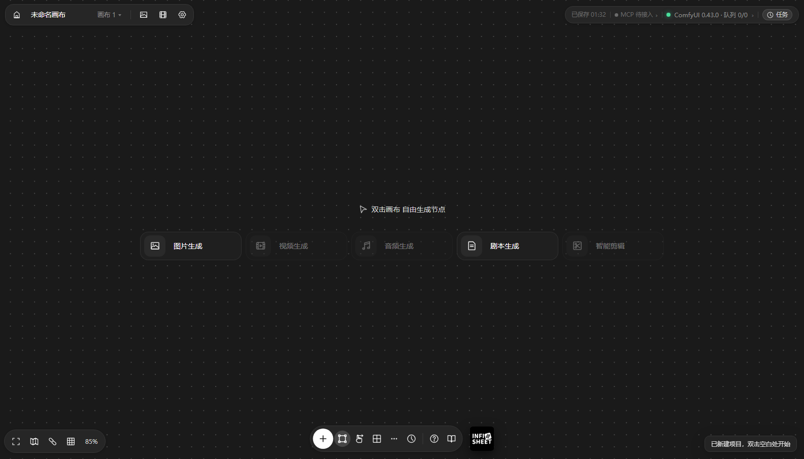
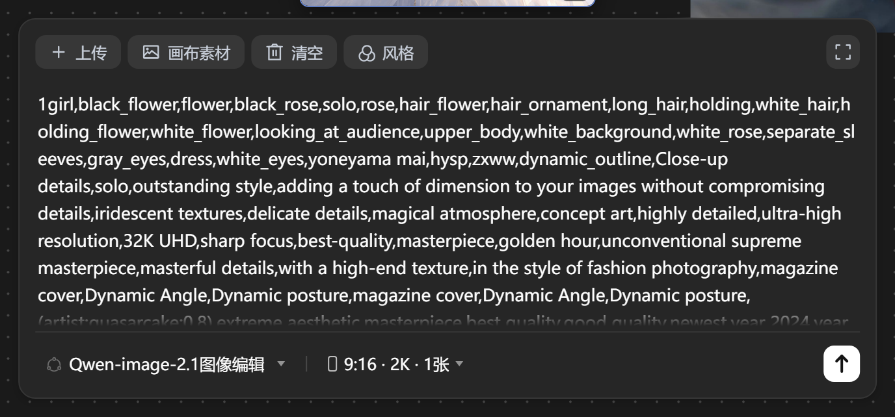
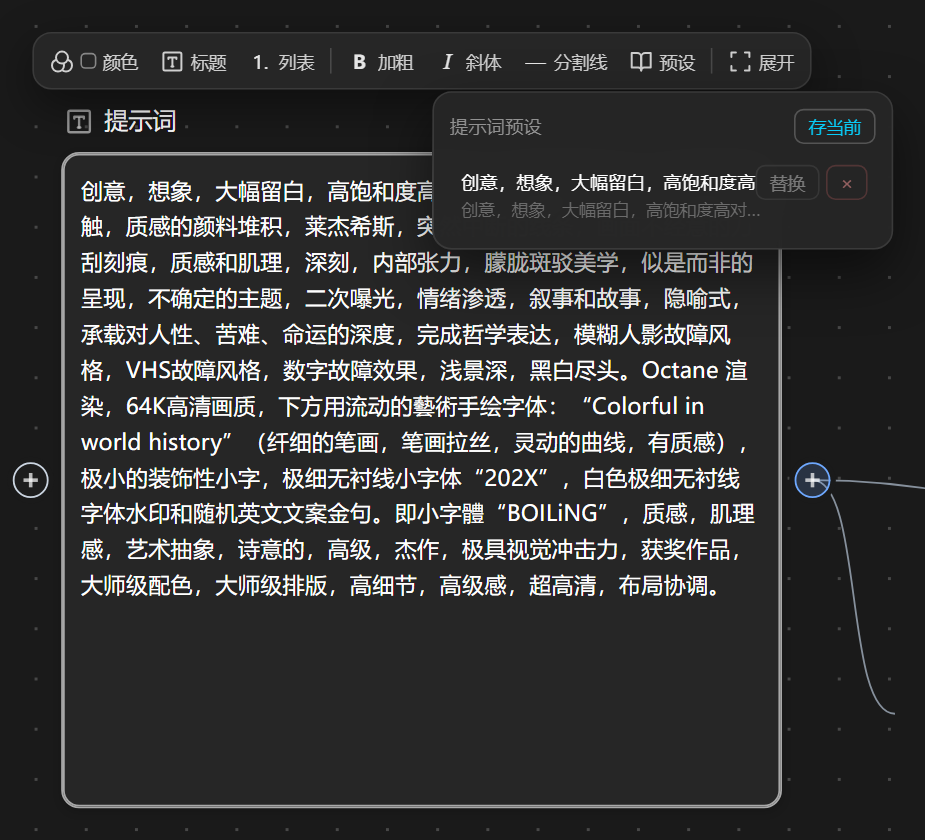

# InfiSheet · 无限画布

一个**零依赖**的本地无限画布，把浏览器里的节点式创作界面直接接到你本机的 ComfyUI（默认 `127.0.0.1:8188`）。
这类节点式创作工具的骨架都是「本地 Node/Python 服务 + Web 画布 + 内置 API 工作流 → 转发给 ComfyUI」。这里用最薄的方式实现它：**一份 Python 标准库服务 + 一份静态前端**，不装任何 npm 包。





| 提示词格式条 + 预设 | 资产库：框选多选 |
|---|---|
|  |  |

## 快速开始

按系统双击对应入口，或命令行启动：

| 系统 | 入口 | 带图标的版本 |
|---|---|---|
| Windows | `启动.bat` | `InfiSheet.lnk`（或双击 `创建快捷方式.vbs` 在桌面生成一个） |
| macOS | `启动.command`（首次右键 → 打开） | `InfiSheet.app`（双击即可，图标是 InfiSheet） |
| Linux | `./start.sh` | `InfiSheet.desktop`（`Icon=` 指向 `static/icon-512.png`） |

`.bat` / `.command` / `.sh` 本身带不了图标——图标由系统按文件类型决定。想让它显示成 InfiSheet，
就得有上面右列那个"外壳"。三个外壳都由 `python tools/icons.py` 从 `static/icon.svg` 生成
（光栅化用本机 Chrome，不额外装依赖）：

| 产物 | 用途 |
|---|---|
| `static/icon.ico` | Windows 图标，16/24/32/48/64/128/256 七档 |
| `static/icon.icns` | macOS 图标 |
| `static/icon-512.png` / `icon-256.png` | Linux 桌面、文档、商店页 |
| `InfiSheet.app/` | macOS 应用包，靠 `$0` 反推项目根，整个目录可以随便搬 |
| `InfiSheet.desktop` | Linux 桌面入口，`%k` 定位项目根；`Icon=` 在非 Linux 上生成时是相对路径 |
| `InfiSheet.lnk` | Windows 快捷方式，**存的是绝对路径**，所以不进版本库（见下） |

Windows 上别直接拿别人给的 `.lnk`：里面写死了路径，换台机器就失效。发 `创建快捷方式.vbs` 更稳——
它按脚本自己的位置算路径，双击在桌面生成一份指向当前目录的快捷方式。

**macOS 打不开的话，基本是这两件事之一：**

```bash
chmod +x 启动.command                          # ① 双击只弹「permission denied」：执行位丢了
xattr -d com.apple.quarantine 启动.command     # ② 提示「无法验证开发者」：去掉隔离标记
```

压缩包（尤其是从 GitHub 直接下载的 zip）解压后不带执行位，`git clone` 下来才有。
两条都不想敲的话，直接在终端里 `bash 启动.command` 也行——脚本本身不依赖执行位。
脚本现在会把失败原因打在窗口里并停住，不会一闪而过。

打开后先看到**首页**：新建画布 / 最近项目（缩略图 + 画布名 + 日期）。

```bash
python server.py                # 默认 127.0.0.1:8788，自动开浏览器
python server.py --port 9000
python server.py --comfy http://127.0.0.1:8188
python server.py --data D:\canvas-data   # 换运行时数据目录（快照 + 工作流库）
python selftest.py              # 接口回归：临时实例 + 42 项断言（需要 ComfyUI），跑完即删
python tests/mcp.py             # MCP 回归：协议 / 23 个工具 / rev 锁 / stdio 桥（不需要浏览器）
python tests/images.py          # 图片链路实测：对**正在跑的那个服务**真出一张，验到像素（需要 ComfyUI）
```

关服务不用去任务管理器：**设置（Ctrl+K）→ 服务 → 关闭服务**，二次确认后进程自己退出、端口释放；
页面会盖一层「服务已关闭」的说明，重新运行启动脚本再刷新即可。

要求：Python 3.9+，本机 ComfyUI 已在运行（`system_stats` 可访问）。无需 `pip install`。

## 多平台运行

三个平台跑的是同一份代码（纯标准库，无原生依赖），区别只在入口脚本和数据目录。

**数据目录**优先级：`--data` > `INFISHEET_DATA` > 程序目录下的 `./data`（存在则沿用）> 平台标准目录
（Windows `%LOCALAPPDATA%\InfiSheet`、macOS `~/Library/Application Support/InfiSheet`、Linux `$XDG_DATA_HOME/InfiSheet`）。
最后那档是为了程序被放进只读位置（`/opt`、Program Files、`.app` 包内）时还能写。

**局域网 / 手机访问**：默认只听 `127.0.0.1`，要对外开放得同时给令牌。

```bash
python server.py --host 0.0.0.0 --token 你的口令
# 浏览器打开 http://<本机IP>:8788/?t=你的口令  → 种下 cookie 后自动跳回干净地址
```

- 令牌只约束**非本机来源**：`127.0.0.1` 和 MCP 的 stdio 桥不受影响。
- 不设令牌又监听 `0.0.0.0` 时服务拒绝启动，除非显式加 `--yes-i-know`（等于把显卡交给同网段任何人，ComfyUI 自己没有鉴权）。
- 手机端目前**只能看，不好编辑**：没有捏合缩放和窄屏布局，触控只覆盖了单指点击。

**ComfyUI 在别的机器上（或换了端口）**：不用改启动脚本 —— 点顶栏那一段 ComfyUI 状态，或在
**设置（Ctrl+K）→ ComfyUI 连接** 里填地址，点「保存并测试」即可。

```
<局域网IP>:8188        → 自动补成 http://<局域网IP>:8188
http://<局域网IP>:8188 → 原样保存（末尾的 / 会被去掉）
```

- 存进数据目录的 `settings.json`，**下次启动还生效**；地址来源会显示在状态行里（默认 / 环境变量 / 设置 / 命令行）。
- 连不上也会保存：先把地址配好、再去启动 ComfyUI 是正常顺序。状态行会标红并说明原因
  （端口没服务 / 超时 / 主机名解析不了 / HTTPS 证书），不是一句「失败」。
- 「恢复默认」= 清掉自定义，回到启动时那一份（`--comfy` / `COMFY_URL` / `127.0.0.1:8188`）。
- 优先级：`--comfy`（这一次运行）> 设置里保存的 > `COMFY_URL` 环境变量 > 默认。
- 访问 ComfyUI 的请求**直连、不走 `HTTP_PROXY`**：开着 Clash / 公司代理的机器上，代理会把本地请求接走，
  于是「ComfyUI 没开」和「代理把它吃了」在界面上长得一模一样。

**Docker / NAS 常驻**：

```bash
docker compose up -d          # 8788 端口，数据挂在 ./data
```

容器里 `COMFY_URL` 必须指向宿主机：compose 已配 `host.docker.internal:8188` + `host-gateway`（Linux 必需）。
只想自己这台机器用就别设 `INFISHEET_TOKEN`；要让同网段访问，在 compose 里打开那行并换成自己的口令。


## 开发

产品运行时零依赖，但仓库里带了一套开发脚手架（测试 / 图标生成 / 打包）。

```bash
npm install        # 只装开发依赖（prettier）
npm run dev        # 8788 + 不自动开浏览器
npm run check      # 所有 js 语法检查 + py_compile
npm test           # 冒烟（不需要 ComfyUI）
npm run test:mcp   # MCP 协议与工具（不需要浏览器）
npm run test:e2e   # 浏览器 e2e（Chrome + CDP，不装 playwright）
npm run shots      # 截一套图到 tests/.tmp/shots/，改完 UI 对比用
npm run pack       # 打 zip 到 dist/
```

细节见 [`docs/DEVELOPMENT.md`](docs/DEVELOPMENT.md)（环境、脚本、加图标、加接口、提交前检查）
和 [`docs/ARCHITECTURE.md`](docs/ARCHITECTURE.md)（服务端路由、前端分区、快照 schema、CSS 分层、已知债）。

改代码前先看 [`docs/CODE-STANDARDS.md`](docs/CODE-STANDARDS.md)：三道质量门（编辑器 / 提交钩子 / CI）、
代码组织约定、异常处理规矩、**Code Review 清单**、新人两周上手路径。
最近一次代码审查（含函数长度分布、上期 P0 现状、两周改进计划）见
[`docs/REVIEW-2026-11-12.md`](docs/REVIEW-2026-11-12.md)。

后续计划：[`docs/GEN-ITERATION.md`](docs/GEN-ITERATION.md)（图片生成的迭代方案）·
[`docs/LLM-NODE-EVAL.md`](docs/LLM-NODE-EVAL.md)（LLM 节点可行性评估）·
[`docs/ROADMAP.md`](docs/ROADMAP.md)（工程侧）· [`docs/FEATURES.md`](docs/FEATURES.md)（其他新功能）。

## 用 MCP 让 AI 直接操作画布

内置一个零依赖的 MCP Server。接上之后，AI 客户端（Claude Desktop / WorkBuddy / Cursor）
可以自己建节点、连线、改参数、跑生成、看结果——**不用打开浏览器**；浏览器开着的话，
AI 建出来的东西会在 4 秒内出现在画面上。

最小配置（stdio，服务没跑会自动拉起）：

```json
{ "mcpServers": { "infisheet": { "command": "python", "args": ["E:\\InfiSheet\\mcp_server.py"] } } }
```

也可以用 HTTP：先 `python server.py`，客户端填 `http://127.0.0.1:8788/mcp`。
23 个工具、典型用法、与浏览器并用的版本锁口径，见 [`docs/MCP.md`](docs/MCP.md)。

**接入面板在「全局设置 → 连接」里**（和 ComfyUI 地址、服务开关同一格——都是「这台机器怎么和外面连」）。
端点、stdio 命令、三个客户端的配置文件路径与 JSON 片段都在那儿，能一键复制，也能直接写进客户端配置文件。
顶栏那盏灯点一下就落到这一格。

接上没有？看画布顶栏那盏灯：客户端握手成功、或成功调用过工具，就显示 **● MCP 已连接 · 应用名**
（如 `MCP 已连接 · WorkBuddy`；灰的 `MCP 待接入` 表示端点就绪但还没人接进来），
悬停能看到应用名与版本、连上时间、已调用次数。

灯也会自己灭：stdio 桥每 10 秒发一次心跳，超过租约（`--mcp-lease`，默认 30 秒）没心跳就显示
**● MCP 已断开 · 应用名**——客户端关窗、崩溃、被任务管理器杀掉都算（桥跟着没了，心跳自然停），
客户端重新接上会自动变绿，不用刷新页面。

应用名有讲究：客户端自报的 `clientInfo` 不可靠——WorkBuddy 报的是 mcp.json 里的**服务器别名**
（`infisheet`），照抄就会在灯上写我们自己的名字。所以自报值等于服务名或占位词时一律不采信，
改用 stdio 桥所在的**宿主进程名**（桥启动时从进程树里读，客户端不需要配合）。

```bash
python tests/mcp.py     # 58 项：协议握手 / 工具链路 / rev 乐观锁 / health 灯数据 / 应用名 / 心跳租约 / stdio 桥
```

## 它能做什么

| 能力 | 说明 |
|---|---|
| MCP（AI 操作画布） | 内置 MCP Server，AI 客户端可以**不开浏览器**直接建节点、连线、改参数、跑生成：23 个工具（项目 / 画布读写 / 生成 / 历史），stdio 与 HTTP 两种接入共用一份实现。浏览器开着时，AI 建的节点 4 秒内自动同步到画面；两边同时写有 `rev` 版本锁，落后的那次保存会被拒绝而不是静默覆盖。顶栏有盏 **MCP 已连接** 指示灯，客户端握手即点亮、心跳停了（客户端退出/崩溃）会自己变「已断开」，悬停能看是谁接进来的；**点这盏灯落到「设置 → 连接」**——端点、stdio 配置、三个客户端的 JSON 都在那一格里，能一键写进配置文件。见 [`docs/MCP.md`](docs/MCP.md) |
| 图片工具条 | 选中一张有图的节点，节点上方浮出十个工具，**图标 + 文案都写着**，按代价分四段：**裁剪 / 旋转 / 调色** ｜ **遮罩 / 擦除 / 去字** ｜ **扩图 / 抠图 / 高清** ｜ **下载**。整条约 580px 宽，会压到旁边节点的标题时先往上让，上面被顶栏挡住就让到节点自己那张图的上沿（不挡任何标题、也不挡生成面板的按钮）。**裁剪**拖一个框裁出新节点（八个锚点、可锁比例）；**旋转**给右转 90° / 左转 90° / 180° / 水平翻转 / 垂直翻转，纯本地重画像素；**调色**是亮度 / 对比度 / 饱和度 / 色温四个滑杆加七个预设（明亮 / 柔和 / 冷调 / 暖调 / 黑白 / 胶片），拖的时候画布上就是滤镜预览，点应用才把同一串 filter 烘进新节点——预览和落地用的是同一份计算，不会「看着调好了、应用出来不一样」。**遮罩**打开全屏涂抹层，涂出要重绘的区域（画笔 / 橡皮 / 撤销 / 粗细 / **颜色 / 透明度**，`[` `]` 调笔刷，Esc 退出），生成时只改涂过的地方：**吃遮罩的工作流**把笔画烘进原图 alpha（一个文件两用、不产生额外文件），**只吃图不吃遮罩的**（Qwen-Image-Edit 这类，参考图插槽吃不到 MASK）自动走**裁切局部重绘**——把涂到的范围连一圈余量裁出来单独跑一次，出图再缩放贴回原位、接缝按遮罩羽化过渡，所以换工作流不用重涂一遍；**涂过的地方会直接叠在节点图上**（颜色和透明度只是显示，不进 alpha），节点标题上留一颗「遮罩 N%」药丸可随时接着涂。**擦除 / 去字**是同一个涂抹层的「一次性」用法：涂完应用会新建一个节点、把这块遮罩带过去并切到能吃图的工作流（优先吃遮罩的局部重绘，没有就退回图像编辑 / 图生图），源图的遮罩不受影响。**扩图**点一下就在这张图上长出**八个锚点**（和裁剪同一套控件，但不再弹浮层）：拖哪边扩哪边，**原图大小一点不变、画布往外长出去**，四边可以各扩不一样（左边多留点放标题也行）；也可以点比例档（1:1 / 4:3 / 3:4 / 16:9 / 9:16 / 四周 +20%）。边框只是状态——**节点下面的生成面板整个收成一条两行参数条**：上行是**多行提示词输入框**（按内容长高，Enter 生成 / Shift+Enter 换行，写的就是这条节点的提示词本身），下行是 工作流 / 尺寸 / 分辨率 / 数量 / 读数 / 取消 / 状态 / 生成，**这一行永远是一行**——工作流名、读数、状态一起变长时各自截断（读数带 title 看全文），不会把生成按钮挤到下一行；面板里原来的 上传 / 画布素材 / 清空 / 风格、大提示词框、底下那排按钮全部让位，不会两处显示同一个值；这一条和工具条一样贴着**画布外框**——工具条在外框上方居中，它在外框下沿外面，框往哪边长它就跟到哪边（放不下时才被屏幕边缘夹住，宁可压住一点画面也不让「生成」跑出屏幕）；`尺寸` 下拉里是 原图 / 1:1 / 4:3 / 3:4 / 16:9 / 9:16 / 四周 +20% / 自定义尺寸…，`分辨率` 按当前比例缩放到目标长边。**生成面板里的尺寸档同步变成这个尺寸**，不会再出现「图上 688×736、面板还停在 1:1 · 1K」那种生成出来尺寸不对的情况。点生成时才真正撑大画布：四条新边留透明；**选的工作流吃遮罩**就再写一层矩形遮罩（只重绘新边，最准），**只吃图不吃遮罩**就靠「透明 → 黑边」让模型整张重画一遍。所以参数条上那个工作流下拉**只列吃图的**，前缀标出「遮罩 / 整图」两条路——选了谁就用谁，不会点生成时被偷偷换成局部重绘。收起不烘（再点扩图 / 参数条上的「取消」/ Esc），尺寸档原样还回去，Ctrl+Z 也能退回扩图前。**抠图**整张交给图像编辑，优先挑名字里带抠像的专用工作流。**高清**新建一个节点、切到真吃得下参考图的工作流、预填提示词补细节。**下载**把这张图按原字节存到本地，文件名取节点标题、扩展名跟着 MIME 走（不是一律 `.png`）。除**扩图**就地改这张图（可撤销）之外，其余八个都是新建节点，原图不动。窗口窄于 1200px 时，**擦除 / 去字 / 抠图 / 高清**收进末尾的**「更多编辑」**（条从 ~590 收到 ~440，1024×768 才摆得开），菜单项写着「需要生成 / 将在新节点中生成」；**裁剪 / 旋转 / 调色 / 遮罩 / 扩图 / 下载**始终在条上 |
| 工具条停靠 | 底部那条悬浮工具条（含右边的圆球「回首页」）可以换位置：**全部功能（⋯）→ 工具条位置**，选底部居中 / 左侧居中 / 右侧居中 / 顶部居中，选择会记住。**停在左右时自动变成竖排**（只占 54px 宽，圆球排到下面），不再横着压掉半个画布。左右只做「居中」——左下角是视图工具、右下角是小地图，放角上会撞 |
| 分组（编组） | 选中 2 个以上节点按 `Ctrl+G` 打组：组框把成员包起来，**组头有 6 种颜色**（蓝/紫/绿/橙/粉/灰，点小圆点换色，颜色跟着存档），**双击组名可改名**（回车保存、Esc 放弃），点组名选中整组、「执行」跑组内所有工作流、「解组」拆开。**整个组框内的空白处都能按住拖动整组**——不用非得瞄准顶部那条标题 |
| 对齐 / 分布 | 选中 2 个以上节点，**选区上方浮出一条图标工具条**（不用先点按钮再选菜单，上面放不下会自动翻到下方）：**左 / 水平居中 / 右 / 顶 / 垂直居中 / 底**六种对齐 + **水平等距 / 垂直等距**，鼠标悬停有中文提示。对齐按整体包围盒算（不是按第一个选中的节点），整批进撤销栈，`Ctrl+Z` 一次退回 |
| 无限画布 | 拖空白平移、滚轮以光标为中心缩放（15% ~ 800%）、网格随缩放变化（两端都收，免得极小时糊成一片、极大时稀得像噪点）|
| 提示词节点 | 一段文本，连到任意工作流的文本插槽。**双击才进编辑**（单击只选中，防误触），`Esc` 退出回只读。选中时节点上方浮出**格式条**（和图片工具条同一套壳）：**颜色**（8 个色板 + 自定义取色 + 恢复默认，默认底色 `#262626`，选中的方块上带一枚当前底色小点）、**标题 / 序号列表 / 加粗 / 斜体 / 分割线**（写进去的是 `<h3>` `<ol>` `<b>` `<i>` `<hr>` 这类语义标签，不是一堆行内 style）、**预设**、**展开**（全屏编辑，`Esc` / 点遮罩 / 「完成」关闭）。格式条贴节点上方居中、被顶栏挡住时自动让到下方；全屏里同一套按钮也在，只是不再重复「展开」 |
| 提示词预设 | 格式条上的「预设」把常用的提示词存起来：**存当前**（把这条节点的文字存成一条，没写名字就取正文前几字）、点一条**插入**到光标处、点「替换」**整段换掉**（连格式一起）、`×` 删除。存的是**纯文本 + 带格式 html 两份**，所以插入只带文字、替换能保住加粗和分割线。落盘 `data/prompt-presets.json`（原子写；文件坏了留档成 `.bad-*` 再重建，不会把库读没），最多 300 条、单条 2 万字；全屏编辑里同样可用。本地自用，不联网 |
| 图片节点 | 选本地图片自动上传进 ComfyUI 的 `input/`，可直接喂图生图 / 图生视频 |
| 图片节点自带生成器 | **选中图片节点**，浮出生成器面板（**位置可选上/下/左/右**，chips 行最左边的「下方 ▾」切换，选择会记住）：提示词 + 工作流 + 参数胶囊（画幅 · 清晰度 · 张数）→ 直接出图落进该节点；参数收进一颗胶囊，点开是分组弹层——**13 种画幅按图形网格排**（胖瘦一眼可比），清晰度带长边像素，还能填**自定义宽高**（自动对齐 16，刷新后依然生效），底部实时报最终出图尺寸；这些数字会真的写进工作流的出图节点，不再出现「选的 1280×720、出来 1024×1024」。工作流没有批量插槽时，选多张会明确告诉你「张数不生效」；提交了 4 张却只回来 1 张时，也会说「只回来 1 张（提交了 4 张）」——那是工作流里有节点把批量并成了一路，而不是提交失败。不想让某张图拖着这块面板，就用双击菜单里的**「加载图片…」**放进来（纯图片节点），要生成时点标题上的「生成」药丸 |
| 风格（397 个预设） | 生成器 chips 行「清空」右边那颗「风格」：Krea2 的 **397 个风格**（动漫 / 摄影 / 绘画 / 素描 / 漫画 / 卡通 / 封面艺术 / 设计 / 数字绘画 / 3D 渲染，10 个分类分页），缩略图网格 + 中英文搜索（跨分类），点一个就收起面板、按钮上直接显示风格名。风格是一句模板 `Style: … Influenced by: … Subject:{prompt}`，生成时把 `{prompt}` 换成你的提示词，**拼好的整句才是真正发给模型的东西**；只选了风格、没写提示词也能出图。画布存档里只存指针 `{cat,i,cn}`（不把四百字的英文模板抄进存档）；读不到风格库时照常出图，只是这次不带风格 |
| 多图结果 | 一次出好几张时，缩略图左下角直接标 `2 / 4`，两侧常显 `‹ ›` 箭头，下方一排圆点也能点；选中节点时 `←/→` 就是翻页（首尾环回）。点开放大后同样能翻页，自带 `n / N`；右侧抽屉给出这张图的**分辨率 / 来源 / 工作流 / 种子 / 生成次数 / 完整提示词**（所有放大入口都是同一套）。**提示词按「真正送进去的那段」显示**：图是连着提示词节点出的时候，这里给的是文本节点里的词，上面多一行「提示词来自 · 文本节点「提示词」」，不会空着写「没有关联的提示词」。选中的那张就是节点当前的图（再拿它去图生图/参考图用的就是这张），刷新后仍停在你选的那张 |
| 生成历史 | 每生成一次就留一条记录，缩略图**右下角**标「N 次」——和左下角的「1 / 4」正好分工：左边管"这一批里的第几张"，右边管"第几次生成"。点开是**三列宫格**（新→旧，当前那次有白框），**单击任意一张进大图**，右侧抽屉列出**分辨率 / 张数 / 种子 / 工作流 / 时间 / 完整提示词**；卡上两个动作：「换回节点」（把那一批图换回节点）和「派生到新节点」（复制全套参数，种子切固定）。最多留 30 条，旧的自动淘汰 |
| 资产库 | 顶栏「资产库」拉出右侧抽屉：**库内文件 + 生成结果 + 上传素材 + 画布上现有的图**全在一个方格网里（列数随抽屉宽度变，默认三列），带来源徽章（库 / 画布 / 生成 / 上传）、文件名搜索、按来源筛选（计数按筛选结果算）。单击看大图（接着往后翻），双击或点「＋」放进画布。**资产库有自己的真实目录**（默认 `<程序目录>/assets`，抽屉底部写着当前路径并标「（默认）」，点「修改…」可换盘换目录、现有文件一起搬过去，清空保存就回到默认）：图放在程序旁边，整个文件夹拷到别的机器图就跟着走。**第一次打开会问一次「生成的图存哪」**——主按钮是「用默认，开始使用」，不点也能先用画布；点过一次、或者库里已经有图（老用户）就不再打扰。分组就是子文件夹（`assets/人像/…`），在资源管理器里直接建文件夹也认，会自己变成一个分组；库内文件能**改名**（磁盘上的文件名真的变）、能**删除**（直接进系统回收站，磁盘上立刻没有，删错了右键还原）。**每次生成完自动存一份进库**，文件名用「时间+序号」（`20261102-203104-01.png`），同一次出的几张不会互相覆盖；存完把 ComfyUI 那边同一张图标成隐藏，列表里不会出现两张一样的图。**删除库外的图**（生成结果 / 上传素材）要在抽屉底部指定 **ComfyUI 根目录**——ComfyUI 没有删文件的接口，只能按 `<根>/output/子目录/文件名` 拼出磁盘路径；没指定时它们只从列表移除（写 hidden），磁盘文件不动，底部「已移除 N 项」点一下找回。**收进库**把 ComfyUI 的产物 / 画布上的图复制一份进来（手动收进库仍用原文件名，用户认得那个名字）。**抽屉宽度可拖**（左边沿那条 7px 的把手，hover 才亮线，双击复位，宽度记在本机；宫格是 `auto-fill`，拉宽就多排几列而不是把缩略图拉大）。**批量选择走框选**：点「选择」进多选态后直接拖一个框，框到的格子一次全选中（`Shift` 拖是追加，不用一张张点）；动作条按「先选、再动手」排成两行——上行「已选 N 项 / 全选 / 清空 / 完成」，下行才是「收进库 / 移动到 / 删除」，「完成」离「删除」最远。多选态里顶栏那颗「选择」会自己让位（屏幕上只留一个「完成」），让出来的宽度给搜索框。**滚动与切分组不卡**：格子 DOM 是复用的（只增删差异，不整片重建）、勾选只切 class、搜索 120ms 防抖、屏外格子 `content-visibility: auto`；缩略图走 `/api/thumb` 的缓存小图（160 / 320 / 640 三档），不会为了 160px 的格子去解码 4000px 原图 |
| 多连输入口 | 图片/文本节点的左侧输入口**可以同时接多个节点**（多条线汇到一个点），接进来的图按顺序进参考图列表；工作流插槽和图片输出口仍是一对一 |
| 参考图（缩略图 + `@`） | 连进图片节点的图、以及提示词里 `@` 引用的图，都在面板顶部排成缩略图（多张时带 1/2/3 序号，缩略图上方写清「提示词里的『图1』」）；**工作流能吃几张就送几张**（Qwen 编辑流是 `images.image_1..4`），按顺序绑定，吃不下的靠后几张不送；`@` 弹出素材菜单（搜索 + 「已关联 / 全部素材」两页，贴着光标弹），选中后 **提示词里直接出现一枚「小缩略图 + 图名」的内联胶囊**，真身是 `@[图名]` 文本，**提交时改写成语义指向**：`@[甲]` → `图1`、`@[乙]` → `图2`（序号＝实际送去模型的顺序），句子结构保持不变 |
| 参考图顺序 | 画布给的图按 `images.image_N` 里的 N 从小到大填：`@` 的第一个引用 → `image_1`，第二个 → `image_2`。多给或少给都安全：多的不送、少的把剩余槽位断开并删掉孤儿 `LoadImage`（否则本地文件名不在 `input/` 里会 400） |
| 工作流节点 | 载入任意 **API 格式**工作流，自动识别可编辑插槽；参数收在节点里的「设置」弹层，节点本身只显示参数数/连线数、运行与设置 |
| 提交前清理 | 工作流自带的图片（导出者本地的 `023.jpg`、他上次跑出来的 `xxx_00483_.png`）会在提交前被摘掉：同一组 `images.image_1..N` 里只留画布绑定的那几张，其余断开并删掉孤儿 `LoadImage`；状态栏写「忽略自带图 N」 |
| 图片输出节点 | 接收工作流节点的结果输出（右侧圆点 → 左侧圆点），生成完成后结果自动流进来；连了输出节点后，工作流节点内不再重复显示结果 |
| 首页 | 点阵背景的「新建画布创作」+ 最近项目（最近生成的缩略图 + 名称 + 日期 + 「⋯」菜单）；`#home` / `#canvas` 两个路由 |
| 空画布起始页 | 新建画布后画布中央浮出「双击画布 自由生成节点」+ 五个能力入口（图片/视频/音频/剧本/剪辑），点一下就把对应内容放进画布，有节点后自动收起 |
| 顶部项目栏 | 左：可改名的**项目名** + `画布 1` 菜单（重命名 / 新建 / 删除）+ 工作流、故事板、**资产库**入口；右：ComfyUI 运行状态 |
| 底部工具条 | **底部居中**的悬浮胶囊（9 项）：`＋` 添加节点 / **框选（默认高亮）** / 移动（抓手）/ 素材库 / 全部功能 / 生成历史 / 快捷键 / 教程 / 首页（渐变球） |
| 左下视图控制 | 整理画布（适配）/ **小地图**（可点跳转）/ 隐藏连线 / 网格吸附 / 缩放档位 |
| 双击新建 | 画布空白处双击弹出节点菜单，就地建节点。菜单分**「新建节点 / 工作流」**两组，每项前面一枚图标（提示词 / 图片 / **加载图片…** / 图片输出 / 打开工作流 / 从 JSON 导入），开在光标右下角 6px 处、贴边时自动翻到另一侧；`↑` `↓` 选、`Enter` 建、`Esc` 关。**「图片」和「加载图片…」是两件事**：前者建一个空白图片节点等你拖文件进去（带生成器面板），后者直接弹文件框、选完就带着图（可多选，多张自动错开 30px 摆），得到的是**纯图片节点**——下面不挂生成面板，选中它也不会冒出提示词/工作流那一大块，就是一张图；想拿它当参考图去生成，点标题右边的**「生成」**药丸，面板才出现（这个标记跟着存档走，刷新不会自己长回来） |
| 拖文件入画布 | 拖入 PNG/JPG/WEBP 自动建图片节点并上传进 ComfyUI `input/`，落点就在松手的位置（多张各错开 30px）。和「加载图片…」同一个口径，得到的是**纯图片节点**（不挂生成面板，想要生成点标题上的「生成」）；拖入 `.json` 则当成 API 工作流导入 |
| 框选 | **拖画布空白处直接框选**（与节点相交即选中），`Shift` 拖为加选；点空白取消选择，松手后提示「已框选 N 个节点」 |
| 打组 | `Shift` 点选加选，`Ctrl/Cmd + G` 打组，组标题上可「执行」整组或「解组」 |
| 插槽自动识别 | 靠 `/object_info` 判断类型：文本 / 种子 / 数值 / 布尔 / 枚举下拉 / 图片；枚举插槽可换模型、换采样器 |
| 结果呈现 | 图片、视频、音频直接显示在节点里，可放大、可「钉到画布」继续当输入 |
| 工作流 | 工作流只有**一份来源**：你的 `data/library/`（不再内置任何模板）。按**自定义分类**分组；生成器下拉、节点选择器都从这里挑。**每份可以有自己的图标**：设置里点名字左边那一格，从 10 个**模型官方商标**（Qwen / FLUX / Stable Diffusion / Krea / Wan 万相 / Hunyuan 混元 / Kolors 可图 / HiDream / LTX-Video / Mochi，`static/logos/` 下的 128px PNG，统一做成白色透明底，配色跟着界面走）里挑一个，或者传一张自己的图（浏览器里先居中裁方、缩到 96px 再传，服务端按内容哈希存进 `data/icons/`，工作流 JSON 里只留 `file:哈希.png` 一行）。选完列表、下拉菜单和画布上的工作流芯片同时换标——不会出现「设置里写着 Qwen、画布上还挂着 Krea 的标」。商标归各自所有者，这里只用来标识对应的模型；要换掉某一张，直接替换 `static/logos/<id>.png` 并把 `app.js` 里的 `WF_LOGO_VER` 加一（那张图带一天缓存）。**默认工作流按能力分类各一份**（文生图 / 图生图 / 高清…，存 `data/wf-defaults.json`）：新建节点按用途预选，没设过就留空让你当场选 |
| 运行记录导入 | 「全局设置 → 运行记录」把 `/history` 里的记录排成**宫格**（封面取第一张产物，多图带角标，没有产物的显示占位块）。**单击看大图**，右侧抽屉列出分辨率 / 节点数 / 产物数 / 采样步数 · CFG · 采样器 / 种子 / 尺寸 / 提示词，卡上「用这个工作流」直接把那次执行的 API 图放回画布（这个最省事，见下） |
| 画布持久化 | 自动存 localStorage，退出时同步到 `data/canvas.json`；也能导出/导入 JSON |

## 首页与路由

- `/`（或 `#home`）→ 首页；`#canvas` → 编辑器。首页右上角工具条的房子图标可随时返回。
- **新建画布创作**：清空并进入编辑器（当前画布已自动存本机，会二次确认）。
- **最近项目**：每张卡片左边是这个画布**最近生成的那张图的缩略图**（没有图就是占位图标），右边两行——画布名 + 日期（`yyyy-mm-dd`），点卡片直接继续；最右的**三个点**展开「打开 / 重命名 / 修改封面 / 删除项目」。重命名是就地改标题（Enter 保存、Esc 放弃）；修改封面可以从这个项目里的图里挑一张，也能从本机选一张（自动缩到长边 800），或者「恢复自动」回到「最近生成的那张」。删除会连存档和封面文件一起删（二次确认，本机快照 `data/canvas.json` 与 localStorage 一并清掉）。注意它和编辑器里的「清空」不同：清空只清节点，删除是把这个画布从本机移除。
- 首页也会显示 ComfyUI 版本与队列，连不上时状态点变红。
- **页脚三件事都就地办完，不往画布里跳**：`ComfyUI 127.0.0.1:8188` 点开是锚在页脚上的小面板（输入框 + 连接状态 + 保存并测试 / 恢复默认 + 在浏览器打开），改完当场生效；`快捷键` 是把「教程与快捷键」浮层直接盖在首页上；`工作流库` 打开全局设置的工作流格，挑中一个才落到画布。以前前两个都会先 `showCanvas()`，改个端口得先进编辑器、开设置、改完再点回首页。
- **空画布起始页**：点「新建画布创作」进入空白画布后，中央浮出「双击画布 自由生成节点」+ 五个能力入口。起始页容器 `pointer-events: none`（只有按钮可点），所以**双击穿透到画布**仍能就地建节点；画布上一有节点它就自动收起。
- 五个能力入口按你实际拥有的工作流自动启用或置灰：服务端读每个工作流的 API 图，按保存节点类型标出 `kinds`（image / video / audio）。能点就直接把「提示词 → 工作流 → 输出」放到位，没有就置灰并提示去「全局设置 → 运行记录」导入；「剧本生成」不需要模型（放提示词节点）；「智能剪辑」本地暂不具备。

## 节点外观

节点外壳与内容分离：

- **标题在卡片外面**：小图标 + 名称 +（工作流节点有「运行」），删除按钮 hover 才出现，不占卡片空间。
- **卡片本体** `.node-card`：圆角 12、1px 描边，选中时描边变蓝。
- **端口**：卡片左右边沿的圆环，中间一个 `+`；插槽里的输入端口保持小圆点，避免噪音。
- **图片节点空态**：居中大图占位 + 「尝试：」下的「上传图片 / 文本生图」两个入口。
- **可拖拽改大小**：卡片右下角有拉伸手柄（hover 或选中时出现）。文本/工作流节点可改宽度；**图片节点不支持缩放**，宽度固定 380，高度按图片原比例自适应（避免手柄和生成器面板/连线抢事件）。宽度下限 200px，上限 760px，尺寸写进画布存档。
- **生成中的反馈**：点生成后，按钮变成旋转加载环，图片中央盖一层「生成中 42%」遮罩——排队时写「排队中…」，轮到自己但还没出步数就写「生成中…」，拿到步数就换成百分比（数字等宽，不会左右抽动），完成后自动消失并显示图片。
- **进度条**：图片节点生成、工作流节点运行时，卡片顶部出现一条细进度条——有真实百分比就按百分比走，拿不到就显示不确定动画，完成/出错后自动收起。百分比来自后端订阅 ComfyUI 的 websocket（浏览器直连会被 ComfyUI 的 Origin 校验挡掉）。**这条通道有个硬要求**：ComfyUI 的 `progress` / `progress_state` 是**指名发给提交任务那个 client_id** 的，所以后端 `/prompt` 里的 `client_id` 和 ws 监听的 `clientId` 必须同一个字符串（`PROGRESS_CLIENT`，唯一出处）；两边写岔了不会报错，只会永远停在「生成中…」。多采样器的工作流按各节点步数加权算总进度，最后一个采样器跑满时报 99%，100% 留给「完成」那一刻。**ws 一个数都没报时**（ComfyUI 刚重启、client 撞车、局域网抖一下），`/api/job` 会退一步去读 ComfyUI 控制台日志（`/internal/logs/raw`）里 tqdm 打的那行百分比兜底，只认本单提交之后的行，所以不会顶着上一单的 100% 不动。前端这边 `progress == null` 只表示「这一拍没拿到新数字」——遮罩、面板状态行、队列条目三处都沿用上一次的数，不会在「生成中 42%」和「生成中…」之间来回跳。
- **顶栏「设置」**（齿轮）：工作流区能导入新工作流、给每个工作流改名 / 换分类 / 删除，**分类本身也能改名 / 新增 / 删除**；行内的 ☆ 把某一份设成它**能力分类**的默认（文生图 / 图生图 / 高清…各一份，存服务端，新建节点按用途预选）；下面还有背景、画布开关、ComfyUI 地址、数据导入导出。
- **生成器**是卡片下方一块独立面板：顶部 chips（上传 / 画布素材 / 清空 / 风格 / 展开）、中间**参考图缩略图 + 大输入框**、底部一条控制栏（`图标 工作流名 ▾ ｜ ▢ 1:1 · 1K · 1张 ▾` + 白色 ↑ 提交），`Ctrl/Cmd + Enter` 也能直接生成。chips 行是按面板宽度自适应的：四个动作按钮放不下就**换行**（换行后与第一个按钮左对齐），绝不会画到面板外面去。参数胶囊点开是「画幅 / 清晰度 / 张数」三段：画幅用 13 个按真实比例变形的小框排成 5 列网格；清晰度是 **1K / 2K / 4K**，按**长边像素**算（1024 / 2048 / 4096），短边跟着画幅缩——所以 1:1 的 1K 是 1024²、16:9 的 2K 是 2048×1152；下面还有**自定义宽高**两个输入框，敲数字就切到自定义档，比例按宽高反推、网格里那一格跟着亮，值自动对齐 16 的倍数；底部一行实时显示「9:16 · 1152 × 2048 · 2.4MP」，超过 4MP 会追加「本地偏慢」。
- **参考图缩略图**：连线进来的图（含挂在左侧文本节点上的）、`@` 引用的图，都排在这里，序号就是提交时的「图N」。排在前面的先占工作流的图片槽位，工作流吃不下的（比如只有一个图片插槽却给了三张）靠后几张不会送进去；`@` 引用带虚线外框，鼠标移上去点 `✕` 取消。缩略图悬停有来源说明（连线 / 经文本节点 / @ 引用）和「提示词里的『图N』」。
- **`@` 引用素材**：在输入框里打 `@`（**紧跟文案也行**，`雪夜@` 就够，不必先敲空格）弹出素材菜单，贴着光标弹，带搜索框和两个标签页：
  - **已关联**——只列已经连进来的图（连线 / 经文本节点）。没连线时这里是空的，只给一行「浏览画布全部素材」，不会凭空摊一堆图让人以为多出了参考图；
  - **全部素材**——画布上其它所有图片，这就是那个「全局选择」；右侧标来源（连线 / 经文本 / 画布）。
  选中即把那张图变成正文里的一枚**内联胶囊**（小缩略图 + 图名），同时加进参考图。同名的图（生成出来的都叫「图片」）自动补 `#1 #2` 序号，胶囊也按序号精确指回那一张。
  胶囊在正文里就是一个字符：`Backspace` 一下整块删掉、回车也不会把它拆开；删掉胶囊＝取消这张参考图，缩略图跟着消失，反之点缩略图的 `✕` 也会把胶囊从正文里摘掉。它的真身是 `@[图名]` 文本——**提交时改写成「图N」，不是删掉**：删掉会得到「把 的画面放进 的排版里」，模型只能瞎猜；写成「图1 / 图2」才对得上真正送进去的那两张（胶囊的 `title` 会直接告诉你「提交时写作『图1』」）。
- **输入框是 contenteditable**：只有这样才能把图片塞进文字里。对外（存档 / 提交 / 撤销）仍然是一段纯文本，`promptText()` 负责把胶囊还原成 `@[图名]`；回车固定插 `<br>`（默认会包一层 `<div>`，正文混满块级元素后光标和选区都不听话），粘贴只收纯文本。

## 图标与圆角

- **图标是手绘的一套 24 栅格轮廓图标**（`static/icons.js`，48 个）：统一 `viewBox="0 0 24 24"`、圆头圆角、描边只声明一次在根 `<svg>` 上，颜色走 `currentColor`。**不引 CDN、不装依赖**，离线可用。
  用法：`window.icon(name)` 或 `<span data-icon="name">`。加图标直接往 `icons.js` 的 `P` 表里加一条 path，没有生成步骤。
  描边粗细由 `style.css` 的 `--oi-stroke` 按渲染尺寸分档（13px 档 2.3 → 20px 档 1.8，24 栅格单位），**不要**在 path 上写 `stroke-width` —— 属性优先级低于任何 CSS 规则，写了会把 `--oi-stroke` 压死（旧版就这么失效过）。
- **形状**：方形图标按钮一律**正圆**（`border-radius: 50%`，dock 32/38、顶栏 32、视图工具 32）；带文字的控件和普通按钮一律**胶囊**（`border-radius: 999px`）。**例外一**：生成器面板内部整块用 **8px 圆角矩形**——上排 chips、底栏两个下拉、展开键、发送键四个控件共用同一个 8px，不再出现「胶囊 + 正圆 + 方角」三种圆角并排；底栏两个下拉的底色跟面板一致，只有 hover / 展开时给一块**不带描边**的 8px 底（胶囊摆在这一行里比下面的提示词还抢眼）。
  **例外二**：首页「新建画布创作」大卡、五个能力入口、最近项目卡保持 16~18px 圆角。
  **例外三**：浮在画布上的那两条工具条——图片工具条、提示词格式条——连同它们的色板 / 全屏「完成」按钮 / 预设气泡里的小按钮，一律 **8px**（`.it-btn` / `.tcp-swatch` / `.tcp-reset` / `.tf-done` / `.tpp-btn`，都已在上面那条 `:not()` 链的排除名单里）。它们贴着节点卡片，胶囊太圆反而像另一套 UI。
  注意 `button:not(…){border-radius:999px}` 那条的 `:not()` 链特异性极高（0,20,1），凡是想要别的圆角的按钮**必须加进它的排除名单**，否则后面写多少条都会被压掉（发送键踩过这个坑：写了 8px，计算值还是 999px）。
- **图标只有一套**：全部在 `static/icons.js` 的 `P` 表里，24 栅格、`viewBox="0 0 24 24"`、描边/填充只在根 `<svg>` 上声明一次（子元素写死 `stroke-width` 会把 `style.css` 的 `--oi-stroke` 光学补偿压死）。生成器底栏那颗「工作流」也一样，就是 `icon('wf')`——它以前是 `app.js` 里单独手绘的 48 栅格「三个圆环串一圈」，自带 `stroke-width="3.4"`，缩到 14px 只剩 1.0px 且糊成一团，也是整个界面里唯一不在同一套体系里的图标。

## 节点与连线

四类节点、三种端口。文本和图片节点之间**可以随意互连**，工作流插槽仍按类型：

| 节点 | 出端口 | 入端口 |
|---|---|---|
| 提示词 | `text` | `any` |
| 图片 | `image` | `any` |
| 工作流 | `media` | `any`（自动落到第一个空闲的文本/图片插槽） |
| 图片输出 | — | `media` |

```
文本/图片 ──any──► 图片        文本当提示词，图片当参考图
图片     ──image─► 文本        图片挂到文本节点上，作为它的参考图
文本/图片 ──any──► 工作流      自动落到第一个空闲的文本/图片插槽
工作流   ──media─► 图片输出
```

- **文本 ⇄ 图片自由连**：三个方向都支持——`文本→图片`（作文提示词）、`图片→图片`（作参考图）、`图片→文本`（图片挂在文本节点上）。文本和图片节点都只有**一个左侧输入口**，但**这个口可以同时接多张图**：多条线汇到同一个点上，几张图按连线顺序排进参考图列表（面板里标 1/2/3）。
- **多张参考图**：每张图的来源可以是连线、也可以是 `@` 引用；工作流有几个图片插槽就送几张（Qwen 编辑流是 4 个），按缩略图序号依次填，提示词里的 `@[甲]` 会跟着写成 `图1`。工作流只吃一张时状态栏会写「参考 1/N」，免得你以为两张都进去了。
- **工作流自带的图会被摘掉**：像 Qwen 图像编辑这类工作流，编码器的 `images.image_1..4` 上钉着导出者本地的图（`023.jpg` 之类）。你在画布上看不见它们，它们却参与条件编码。提交前会**只保留你绑定的那几张**，其余从下游断开、孤儿 `LoadImage` 整颗删掉（不然那个本地文件名不在 `input/` 里，ComfyUI 校验整图时会 400），状态栏写「忽略自带图 N」。画布一张图都没给时**原样不动**——这类多图输入是必填的，拆空会直接报错。
- **图片→文本的用处**：那张图会作为这条提示词的参考图，跟着文本一起送进下游图片节点——等于「提示词 + 参考图」打成一个包。
- **失败要说清「哪里报错」**：以前只有一句 `失败：<一坨字符串>`——分不清是上传、构建还是 ComfyUI 里某个节点，被那一行截掉的后半句还永远看不到。现在服务端把 ComfyUI 的 `execution_error` 拆开（`node_id` / `node_type` / 异常类型 / 消息，节点标题从**这次提交的那份图**里捞，所以写的是「加载图像」而不是 `LoadImage`），面板状态行直接写「**工作流有错 · 加载图像 · LoadImage（节点 3）**」，点这一行弹详情卡片（在哪 / 异常 / 消息 / 建议 / 复制错误）。还没提交就失败的那几段（载入工作流 / 分析工作流 / 构建参数 / 提交任务）也各自带着阶段名，不会只剩一句「工作流为空」。
- **状态行单独一行**：底栏要放工作流名、画幅、张数、生成键，四样东西谁长了都得截，而**报错恰恰不能截**。所以状态文字从底栏搬了出来，整宽一行、可以折行；空的时候整行收起来不占高度。
- **工作流名不截断**：底栏那颗工作流按钮以前压着 `max-width: 48%`，名字稍长就变成「Qwen-image-2.1 图像…」，而「我选的是哪个工作流」是这一行里最不能猜的信息。现在它的宽度跟着名字走（`min-width: fit-content`），真长到一行放不下时由底栏换行把参数和生成键挪到下一行，也不把名字切开。
- **拖图 = 拖节点**：图片节点里的图关掉了浏览器原生拖拽（不会拖出半透明 ghost），按住图直接移动节点。
- **看大图**：单击图片不再弹大图；鼠标移到图片上，左上角出现「查看大图」按钮，**双击图片**也会打开——大图按窗口自适应（92vw × 92vh），Esc 或点背景关闭。
- **连线的头尾都能拖**：空输入口可以反向拖到任意输出口。
  已经连着线的输入口，**拖 = 再添一条**（多连的材质口没法用「拖走」表达摘哪一根）；**原地松手 = 点了一下**，会把这个口上的线全断开（可撤销）。工作流插槽和图片输出口仍是「拖走 = 摘下来重接」。
- **删连线**：单击线即选中（线变亮变粗），**线的中点会浮出一个小圆钮**，点它就删掉这条线；也可以选中后按 `Delete` / `Backspace`，或者直接把输入口那端拖走。圆钮挂在屏幕坐标上，缩放到 200% 也是 22px，位置始终贴着曲线中点（按路径长度取一半，不是两端平均——反向连线会吊下来一截）。删错了 `Ctrl+Z` 能救回来。
- **多项目 + 最近项目**：每次「新建画布」都会在服务端建一个独立项目（`data/projects/<id>.json`），首页「最近项目」按更新时间列出所有项目（缩略图 + 名称 + 日期），点开即切换、卡片右侧「⋯」里删除；封面默认取「最近生成的那张」（`/api/projects` 顺手算出来，`data:` 图落到 `data/covers/<id>.img` 再发地址，列表里不塞 base64），也能在「⋯ → 修改封面」里换；切换/离开编辑器都会先自动保存，新建后也会立刻落盘一次，所以关掉再打开不会丢。老的单文件 `data/canvas.json` 会自动迁移成 `legacy` 项目。
- **自动保存 + 历史画布**：编辑停下来 0.6s 就把画布 POST 到本地存档，顶栏状态条显示「已保存 HH:MM」；服务端每次覆盖前把旧版本归档到 `data/history/`（内容相同或距上次不足 60s 跳过，最多留 30 份）。「全部功能 → 历史画布…」可看时间/节点数/连线数并一键恢复。
- **界面格式也能导**：ComfyUI 菜单「工作流 → 保存/导出」得到的 JSON（`nodes`/`links`/`widgets_values`）可以**直接拖进画布**，服务端按 `object_info` 复刻 `graphToPrompt` 转成 API 图（连线、控件值、seed 的 control_after_generate、Reroute、Bypass、PrimitiveNode 都处理了）；**子图（Subgraph）会自动展开**（边界 -10/-20 换回真实来源，内部节点加前缀避免撞 id）。
- **拖入工作流文件**：把 API 格式的 `.json` 直接拖进画布，会在落点建一个工作流节点（文件名当标题）；「全部功能 → 导入工作流 JSON…」也能选文件。拖进来的若是 ComfyUI 界面格式（`nodes`/`links`），会提示改用「工作流 → 导出(API)」，不会建出坏节点。
- **工作流全部由你自己攒**：程序**不内置任何工作流**（早先那份随包分发的 `presets/` 已整档删掉）。生成器下拉和节点里的工作流选择器列的就是 `data/library/` 里的文件，按分类分组。第一次用先拖一个 API 图进去（或「导入工作流…」）——选哪个、叫什么、归哪类，全在你手上。
- **分类可以自己定**：全局设置 →「工作流 → 分类」里能改名 / 新增 / 删除（存服务端 `data/workflow_categories.json`，换设备也在）。列表里每个工作流：点名字改名、点分类胶囊换类、点 × 删除。**分类只是「我怎么归类」，不影响生成时用哪个**——用哪个永远在节点的面板里选。
- **改名 / 换分类 / 删除都是真文件操作**：列表就是 `data/library/` 本身，改名写进那份 JSON 的 `title`，删除就是删文件（点了会先确认）。不再有「覆盖层 / 隐藏 / 恢复出厂」那一套——以前为了不碰随包分发的 `presets/`，这些改动只能记在 `data/preset_meta.json` 里，删除也只是「从列表隐藏」，用户看到的和磁盘上的对不上。
- **清理残留就是就地改**：查到导出者留下的痕迹（`LoadImage.image`、文本值），清理直接写回**同一份**库文件，列表里仍是同一条。以前是另存一份「xxx 已清理」进工作流库，同一个工作流在列表里出现两次，自动挑工作流命中哪一份全看排序——这就是「清完还是重复」的来源。
- **默认工作流按分类各一份**：设置里点行内的 ☆ 把某份设成它能力分类（文生图 / 图生图 / 高清放大 / 视频 / 音频）的默认，存服务端 `data/wf-defaults.json`（换设备、MCP 都读同一份）。新建图片节点按「文生图」预选，编辑 / 高清入口按用途取默认；某个分类没设过就留空，面板上写「未选择工作流」。以前是「全局一个默认存 localStorage」，换浏览器就没了、也说不清这次用的是哪份，所以删过一版；现在按分类 + 显式设置，面板上直接显示名字。
- **工作流库就是全局设置的第一格**：顶栏齿轮打开的就是它，不再单独有一颗工作流库按钮（同一个面板、同一个落点，摆两个入口只会让人猜哪个不一样）。底部 dock 的 `⊞` 也落到这一格——那个是「挑一个加到画布」，在画布上顺手。
  以前是「设置一条长滚动」+「资产库一整个弹窗」，同一个工作流列表在两处渲染：弹窗里只能挑，
  设置里只能管。现在一份列表两件事都能做——顶上搜索框（按名字或分类过滤）+「导入工作流…」，
  一行六件套：点名字改名 / 点分类胶囊换类 / 「加到画布」把它变成节点 / ☆ 设该能力分类的默认 / 放大镜检查残留 / × 删除。
  以前这里还并着一份随程序分发的 `presets/`，同一份工作流能出现两次（内置一条、自己存一条），
  删除还只能「隐藏」。内置预设整档删掉之后，列表就是库本身。
- **残留检查随时能再跑一次**：导入那一刻会弹一次「这份工作流带着导出者的痕迹」，可文件一旦躺进列表，
  想再确认一遍（或者怀疑某张图不是自己出的）原来没有任何入口。现在每行末尾那颗**放大镜**就是它：
  干净的直接回一句「是干净的」，查到了就列出条目让你勾。清理**直接写回那份库文件**，列表里仍是同一条，
  不产生副本。以前是另存一份「… 已清理」到工作流库，同一个工作流因此在列表里出现两次——清完还看到
  重复，就是这么来的。
- **画布背景可换**：全局设置 →「外观」，5 个预设色（石墨 / 墨黑 / 雾蓝 / 暖灰 / 纸白）+ 自定义取色，纹理支持点阵 / 网格 / 纯色；选择存在 localStorage，刷新后保持。
- **全局设置是「左导航 + 右分格」**：工作流 / 运行记录 / 外观 / 连接 / 高级，一次只显示一格。
  面板尺寸写死（880×640，小屏按 `94vw` / `90vh` 兜底）——以前是高度自适应，切一格内容变少窗口就缩一下，
  同一个面板跳两次。运行记录那一格**点开才去问 ComfyUI**，所以离线开设置不会先在控制台红一条。
- **添加工作流**：把 `.json` 拖进画布、双击空白菜单里的「从 JSON 导入…」、「全部功能 → 导入工作流 JSON…」，三条路都是「在落点建一个工作流节点」；载入后自动识别插槽。
- **全局设置里还有什么**：外观（背景色 / 纹理 + 网格吸附、显示连线、小地图、自动保存四个开关）、连接（ComfyUI 地址 + 保存并测试 / 恢复默认 / 关闭服务）、高级（适配视图 / 导出 / 导入 / 历史画布 + 快捷键 + **关于：显示版本、检查更新**）。开关存 localStorage，跨项目生效。
- **检查与安装更新**：设置 → 高级 → 关于，点「检查更新」查看 GitHub 最新 release。有新版时，发行 ZIP 安装可点「下载并安装」；需要再次确认，更新器会先下载并校验 ZIP 与版本，再暂存备份、保留 `data/`、替换程序并重启。新版启动检查失败会恢复旧文件并重新启动旧版。Git 源码目录和 Docker 容器不自动覆盖，仍可打开 Release 页手动更新。GitHub API 限流时会尝试从发行页读取版本和程序 ZIP 链接；断网或没有可用 ZIP 时会说明原因。检查结果缓存 10 分钟。
- **复制 / 粘贴**：选中节点后 `Ctrl+C`，`Ctrl+V` 粘到鼠标位置（节点之间的连线一起复制），`Ctrl+D` 原地创建副本；「全部功能」菜单里也有。
- **撤销 / 重做**：`Ctrl/Cmd+Z` 撤销、`Ctrl/Cmd+Shift+Z`（或 `Ctrl+Y`）重做，最多 40 步。快照只包含画布结构（节点/连线/分组/参数），不包含缩放位置；「全部功能」菜单里也有这两项。
- **图片右上角显示原始尺寸**：`1024 × 1024` 这类像素尺寸浮在图片右上角，生成/上传/切换组图后自动更新；空节点不显示。
- **工作流节点是一个整体**：左侧只有一个 `any` 口，文本/图片都能接，按来源自动落到第一个空闲的对应插槽（满了会提示先断开）；右侧是结果输出。类型仍要匹配插槽（文本写不进图片输入）。
- **工作流的参数不铺在节点上**：节点只显示「N 个参数 · N 条输入」、运行状态和「运行 / 存入工作流库 / 设置」。点「设置」或点输入口，打开设置弹层：上半是输入插槽（带 `⛓ 已连线`，点一下就断开），下半是其余参数，按 ComfyUI 原样分组。
- 端口按类型上色：text 蓝 / image 绿 / media 紫 / any 灰白，拖动时能接的端口会亮起。
- **数值/种子/开关/下拉不再有端口**：它们是节点里的控件。旧版在这些插槽上挂的圆点接不了任何东西，纯噪音，已去掉（一个 9 节点工作流的 17 个端口变成 2 个）。
- **断开**：点已连线的输入口 = 断开这一口上的全部连线；只想去掉其中一张，就在生成器面板的缩略图上点 `✕`（连线来的只摘那一条）。工作流的插槽在设置弹层里点「⛓ 已连线」。
- **怎么连都不容易失手**：松手按「命中的端口 → 目标节点上自动接第一个可接插槽 → 26px 内最近端口」逐级兜底，所以把线拖到卡片任意处就行。
- **旧画布自动迁移**：图片节点上旧的 `prompt` / `ref` / `in` 链接统一成 `in`，不会再被丢掉。
- **连线形态**：三次贝塞尔，**首尾都是水平切线**——从输出口平着出来、从左边平着进入口。高差大时走一条平滑的 S 弯（不再是「横 → 竖 → 横」的折线，那种画法在拐角处是硬直角，多个来源汇到同一个口还会叠成一条竖线）；反向连接（目标在源左边）两端各自往外甩并带一点垂度，免得退化成一条直线横穿中间的节点。
- **拖拽建节点**：从端口拖出来、在**空白处**松手，会弹出「接一个节点」菜单（工作流 / 图片输出 / 文本 / 图片），选一个就就地新建并自动接上。
- **节点自适应**：文本节点随内容自动增高；图片节点按图片原始长宽比自动调整高度（`object-fit: contain`，不裁切），尺寸变化后连线会立即重算。
- 一个工作流可以同时连多个输出节点（比如一次跑多张，分开展示）。
- 输出节点为空时显示占位提示；断开后不再接收新结果，但已显示的内容保留。
- 输出节点里的图同样可以「钉到画布」变成图片节点，继续接图生图/图生视频。

首次打开会自动摆好「提示词 → Krea2 文生图 → 图片输出」三节点并连好线。

## 怎么把自己的工作流放进来

**关键：画布吃的是 API 格式（`prompt` 图），不是前端 UI 格式。**

三条路，从省事到麻烦：

1. **从运行记录抓**（推荐）
   在 ComfyUI 里正常打开你的工作流（例如 `MiniMax+H3+导演台`）、点一次「运行」。然后回到画布 → `＋ 工作流` → 「ComfyUI 运行记录」→ 点那条记录。
   因为 ComfyUI 的 `/history` 里存的就是它当时真正提交的 API 图，所以**100% 与你跑通的版本一致**，含所有自定义节点。

2. **导出 API**
   ComfyUI 菜单 → 工作流 → **导出(API)**，把 json 拖进画布的「粘贴 / 选文件」。

3. **直接粘 JSON**
   同上，只是用剪贴板。

> 为什么不能直接读 `user/default/workflows/*.json`？
> 那些是前端格式，新版 ComfyUI 的很多工作流（比如本机的 `image_krea2_turbo_文生图.json`）内部含 **Subgraph（子图）节点**，需要前端展开才能变成可提交的图。画布不猜测你的图结构，只接受已经展开好的 API 图——宁可让你多点一次「运行」，也不给你一个会静默跑错的转换器。

程序**不内置任何工作流**：早先那份随包分发的 `presets/` 已整档删掉，第一次用要自己导一份进来（`tests/fixtures/workflows/` 里放着几份实测过、能直接用的样本，也可以当作格式参考：`Krea2-Turbo-int8` + `qwen3vl_4b_fp8_scaled`（type=`krea2`）+ `qwen_image_vae`，默认 14 步）。

## 文件结构

```
infisheet/
├── server.py              # 本地服务（Python 标准库，零依赖）
├── mcp_server.py          # MCP Server：JSON-RPC + 21 个画布工具；stdio 模式是 HTTP 的薄转发
├── selftest.py            # 接口回归（起临时实例、断言契约、真跑一个小任务；需要 ComfyUI）
├── 启动.bat               # Windows 一键启动
├── 启动.command           # macOS 一键启动（首次右键 → 打开）
├── start.sh               # Linux / 任何有 bash 的环境
├── InfiSheet.app/         # macOS 应用包：双击启动，图标是 InfiSheet（tools/icons.py 生成）
├── InfiSheet.desktop      # Linux 桌面入口（同上）
├── 创建快捷方式.vbs       # Windows：双击在桌面生成带图标的快捷方式（按自身位置算路径）
├── Dockerfile             # 容器镜像（数据挂 /data）
├── docker-compose.yml     # 8788 + ./data + host.docker.internal 指向宿主机 ComfyUI
├── package.json           # 只有开发脚本与开发依赖，产品运行不需要
├── static/                # 前端（原生 JS，无构建）
│   ├── index.html
│   ├── icons.js           # 手绘 24 栅格图标集（静态 path，零依赖）
│   ├── app.js
│   ├── style.css
│   └── styles/            # 397 个风格预设：index.json（分类清单）+ 每类一个 json + thumbs/ 缩略图
│                          # 由 tools/import_styles.py 从素材包导入，改完重跑一遍即可
├── data/                  # 运行时生成（不进版本库）
│   ├── settings.json      # 界面里改过的设置（目前是 ComfyUI 地址）
│   ├── canvas.json        # 旧版单画布快照（自动迁移用）
│   ├── projects/          # 每个画布一个 json
│   ├── history/           # 自动保存的历史版本（保留 30 份）
│   ├── prompt-presets.json # 提示词预设（格式条上的「预设」）
│   ├── wf-defaults.json   # 按能力分类记的默认工作流（文生图 / 图生图 / 高清…）
│   ├── thumbs/            # 资产库缩略图缓存（按「源 URL + 宽度」命名，可随时删）
│   └── library/           # 工作流库：**唯一**的工作流来源，一个文件一个工作流
├── tests/
│   ├── fixtures/workflows/ # 工作流样本（真机导出的 API 图），smoke / mcp / selftest / e2e 共用
│   ├── smoke.py           # 无依赖冒烟（静态/接口/项目 CRUD/防穿越 + 启动守卫/令牌/数据目录）
│   ├── mcp.py             # MCP 协议与工具回归（协议 / 工具链路 / rev 锁 / stdio 桥）
│   └── e2e/               # CDP 驱动的浏览器测试（run / walkthrough / probe）
├── tools/
│   ├── icons/gen.cjs      # IconPark → static/icons.js
│   ├── import_styles.py   # 风格素材包 → static/styles/（抄 json + 缩 160px 缩略图 + 写 index.json）
│   ├── check.mjs          # 语法自检
│   └── pack.py            # 打 zip
├── docs/                  # DEVELOPMENT.md / ARCHITECTURE.md / MCP.md / 截图
├── .github/workflows/     # CI：check + smoke + e2e
└── 验收报告.md            # 逐轮浏览器验收与修复记录
```

打包分发：

| 压缩包 | 内容 |
|---|---|
| `infisheet-<版本>-<日期>.zip` | 程序 + 工程文件：`server.py` / `mcp_server.py` / `selftest.py` / 三个平台的启动入口（`启动.bat` `启动.command` `start.sh`）/ `Dockerfile` + `docker-compose.yml` / README / 验收报告 / `static/` / `tests/` / `tools/` / `docs/`，**不含 `data/` 和 `node_modules`**（也不再带 `presets/`：工作流全在 `data/library/`） |
| `infisheet-data-<版本>-<日期>.zip` | 只有 `infisheet/data/`（画布项目 / 历史 / 工作流库），解压到同一层合并 |

两个包都用 `npm run pack` 生成（`python tools/pack.py`，`-- --with-data` 连存档一起打）。
解压后直接双击 `启动.bat`（或 `python server.py`）即可；`data/` 不存在时服务会自动重建空目录。

自测默认会往 ComfyUI 丢一个 `EmptyImage → SaveImage` 的 64×64 秒级任务（不占模型），
不想动队列就加 `--no-run`，只验接口契约。

## 服务端接口

| 方法 | 路径 | 作用 |
|---|---|---|
| GET | `/api/health` | ComfyUI 版本、显存、队列长度；`comfy_url` / `comfy_source` 说明当前连的是哪台 |
| GET | `/api/version` | 本地版本号（读 `package.json`，不联网）+ 仓库地址；设置里「关于」那一行用它 |
| GET | `/api/update/check` | 比对 GitHub 最新 release：`current` / `latest` / `hasUpdate` / `url` / `notes` / `zip` / `canInstall`。结果缓存 10 分钟，`?force=1` 绕过；限流时回退到 Release 页面读取版本和程序 ZIP。只检查，不下载 |
| POST | `/api/update/install` | 无请求体；发行 ZIP 安装且确有新版时，在独立更新进程中下载、校验并暂存，然后关闭服务、备份并替换程序文件、重启和验证新版；失败时回滚。拒绝 Git 源码目录和容器安装；`data/` 不在更新包内，也不会被更新器覆盖 |
| GET | `/api/update/status` | 读取当前更新任务状态：下载、校验、重启、完成或失败；不返回启动参数或令牌 |
| GET | `/api/comfy` | 当前 ComfyUI 地址 + 来源（默认 / 环境变量 / 设置 / 命令行）+ 试连结果（`reachable` / `version` / `ms` / `error`） |
| POST | `/api/comfy` | `{url}` → 校验（只收 http/https、端口 1~65535）→ 试连 → 存进 `settings.json` 并立即生效；连不上也保存，回 `saved:true, reachable:false, error:...`。`url` 传空 = 清掉自定义、回到启动时那一份 |
| GET | `/api/models/{folder}` | 列出 `checkpoints` / `diffusion_models` / `loras` 等 |
| GET | `/api/history?limit=N` | 最近运行记录（含 API 图与产物） |
| GET | `/api/assets?limit=N&refresh=1` | 资产列表：**先扫资产目录**（`root/` 与 `root/组名/` 两层，`source=lib`，`url` 指向 `/api/assets/file`），再从 `/history` 里索引生成产物（`source=output`）与 `LoadImage` 用过的上传图（`source=input`）。每项带 `key`（库内是 `lib:相对路径`，外部是 `source:subfolder/filename`，画布图是 `canvas:项目:节点:序号`）与 `group` / `hidden`；另回 `root`（当前存放目录）、`groups`（分组表，含磁盘上发现但没登记的文件夹）和 `meta`。ComfyUI 不可达时退化成只有库内文件 + `comfy=false`（不报 5xx），缓存 5 秒，`refresh=1` 绕过（目录与分组不进缓存） |
| GET | `/api/assets/file?path=相对路径` | 取资产库目录里的原图。只接受 `root` 之内的相对路径，`../`、绝对路径一律 400；改名 / 挪组之后 URL 会变，所以不带缓存 |
| POST | `/api/assets/lib` | 资产库的写操作，`{op}` 分发：`group-add{name}` / `group-rename{id,name}`（目录跟着改名）/ `group-remove{id}`（组内文件搬回未分组）/ `assign{keys,group}`（库内文件真搬目录，外部只记归属）/ `hide{keys,hidden}`（外部来源的移除/找回）/ `import{items,group,nameMode}`（收进库：ComfyUI 的图走 `/view` 取字节，画布图由前端带 base64；`nameMode:"time"` = 按「时间+序号」命名，自动入库用这个；同一个 ComfyUI 文件重复收只存一份）/ `rename{key,name}`（库内改名，扩展名保留）/ `delete{keys}`（**真删**：移进系统回收站；库外要配了 ComfyUI 目录才删得到，否则只写 hidden）/ `root-set{path}`（换存放目录并搬文件，`path` 传空 = 恢复默认）/ `comfy-dir{path}`（指定 ComfyUI 根目录，填 output/ 也认）。回包带最新 `groups` + `meta` + `root` + `rootDefault` + `comfyDir` |
| GET | `/api/thumb?w=320&src=/api/assets/file?…` | 宫格用的小图。按「源 URL + 宽度」sha1 落盘缓存（`data/thumbs/<sha1>-<w>.jpg`），只做 160 / 320 / 640 三档；源只认自家 `/api/assets/file` 与 `/api/view`（外部 URL 一律 400，不做开放代理），超过 48MB 的原图直接回原图不处理。`w` 会吸附到最近档位。**PIL 是可选依赖**：没装就原样回原图（功能照常，只是更吃内存），不破坏「零依赖」这条线。回包带 `Cache-Control: public, max-age=604800`（路径里已经含内容指纹，改名换目录都会换 URL） |
| GET | `/api/prompts` | 提示词预设列表（按最近保存倒序）。 |
| POST | `/api/prompts` | 预设的写操作，`{op}` 分发：`save{name,text,html}`（不给名字就取正文前几字）/ `update{id,name?,text?,html?}` / `remove{id}`。落盘 `data/prompt-presets.json`（tmp + `os.replace` 原子写，坏文件留档成 `.bad-*` 再重建）。上限 300 条、单条文本 2 万字 / html 8 万字、名字 60 字，超了截断而不是报错 |
| GET | `/api/setup` | 首次使用引导的状态：`needsSetup`（要不要问）、`defaultDir`（默认目录）、`root` / `rootDefault`（当前）、`writable` + `why`（**试写一个临时文件**再删，目录能建不等于能写：Program Files / `.app` 包内 / 只读挂载 / 断线的网络盘都在这里拦住）。点过引导（`settings.json` 的 `setup_done`）或库里已经有图，`needsSetup` 就是 false |
| POST | `/api/setup` | 引导的两个按钮：`{action:"default"}` 用默认目录 / `{action:"set",path}` 存到指定目录（内部复用 `root-set`：绝对路径校验 + 搬文件 + 可写预检），成功后记 `setup_done`，回包是最新的引导状态 |
| POST | `/api/analyze` | `{graph}` → 识别出的插槽与输出节点；界面格式（`nodes/links`）会先由服务端转成 API 图，**并在响应里带回转换结果**（`graph`），前端存这份。响应里的 `residue` 是残留体检结果 |
| POST | `/api/residue` | `{graph}` → `{residue, graph, source, partial}`。导入前的残留体检：`LoadImage.image` 非空（导出者机器上的文件名，换台机器就不存在）与文本槽位非空（他上次写的那句话）各报一条，`auto` 标明能不能默认清。`source` 是 `api` / `ui`（界面格式会顺手转成 API 图并回传）。ComfyUI 没连上时只报图片那一类，`partial:true`——**检查失败不能拦住导入** |
| POST | `/api/run` | `{graph}` → 提交到 `/prompt`，返回 `prompt_id` |
| GET | `/api/canvas/history` | 列出画布历史快照（时间/名称/节点数/连线数） |
| GET | `/api/canvas/history/<file>` | 读取某份历史快照 |
| GET | `/api/job?pid=` | 合并 `/history` 与 `/queue` 判断状态，返回产物列表与 `progress`（后端订阅 ComfyUI websocket 拿到的百分比；ws 没数时用控制台日志里 tqdm 的百分比兜底，都拿不到为 `null`） |
| POST | `/api/cancel` | 取消排队 / 中断执行 |
| POST | `/api/queue/cancel` | `{prompt_id}` → 只取消**一个**任务：排队中的从 `/queue` 删掉，正在跑的走 `/interrupt`（先查队列确认它真在 running 里，否则会把别人的任务杀掉）；已经结束的回 `removed:false` 而不是报错 |
| POST | `/api/upload` | 转发到 ComfyUI `/upload/image` |
| GET | `/api/view?...` | 代理产物文件（图片/视频流；透传 `Range`，视频能拖进度条） |
| GET/PUT/DELETE | `/api/library/{name}` | 工作流库读写（PUT 覆盖时保住已有的标题 / 分类，从画布「存入工作流库」不会把归好的类打回原样） |
| GET/POST | `/api/wf/categories` | 工作流分类表（用户自己的归类：改名 / 新增 / 删除 / 排序），存在 `data/workflow_categories.json` |
| POST | `/api/wf/meta` | `{id, title?, group?}` → 改一个工作流的标题 / 分类；`id` 是 `preset:xxx.json` 或 `lib:名字`。**预设改的是 `data/preset_meta.json` 那一层覆盖，不写回 `presets/`**（那个目录随程序分发，升级会整份覆盖） |
| POST | `/api/presets` | `{title, graph}` → 存成内置预设写进 `presets/`（界面格式会自动转 API 图；重名自动加 `-2`） |
| DELETE | `/api/presets/{file}` | 删除内置预设（`krea2-文生图.api.json` 这类文件名，非法名 400、越界 403）。**不是 unlink**：只记一条「隐藏」，文件原地不动，随时能恢复 |
| POST | `/api/presets/{file}/restore` | 恢复出厂：撤掉这个预设在 `data/preset_meta.json` 里的覆盖（改名 / 分类 / 隐藏一起回来） |
| GET/POST | `/api/projects` | 列出 / 新建项目（多画布） |
| GET/POST/DELETE | `/api/projects/<id>` | 读取 / 保存 / 删除某个项目。保存时带 `baseRev`：落后的写入回 `{stale:true}` 而不是覆盖（MCP 与浏览器共用一个存档靠它）。`?meta=1` 只回版本号（`rev` / `lastWriter`），前端每 4 秒探一次 |
| GET | `/api/mcp/setup` | 接入面板的数据：MCP 端点、stdio 命令、三个客户端（WorkBuddy / Claude Desktop / Cursor）的配置文件路径与 JSON 片段 |
| POST | `/api/mcp/install` | `{client}` → 把 `infisheet` 条目写进该客户端配置（白名单客户端 + 备份 + 原子写；现有文件不是合法 JSON 就拒绝，原样保留） |
| POST | `/api/mcp/heartbeat` | stdio 桥的保活心跳，回租约秒数；超过租约没心跳，`/api/health` 里 `alive=false`，顶栏灯变「已断开」 |
| GET/POST/DELETE | `/mcp` | MCP 端点（Streamable HTTP + JSON-RPC 2.0）：`POST` 收发消息、`GET` 回 405、`DELETE` 结束会话 |
| GET/POST | `/api/canvas` | 画布快照读写 |
| DELETE | `/api/canvas` | 删除画布存档（移除 `data/canvas.json`） |
| POST | `/api/shutdown` | 关闭服务：先回 `{ok,stopping}`，再由后台线程停进程（顺序反了响应会被掐断）。跨站 `Origin` 回 403 |

访问令牌（`--token` / `INFISHEET_TOKEN`）只约束**非回环来源**：`127.0.0.1` 与 MCP 的 stdio 桥不受影响；
被挡的接口回 `401 {ok:false}`，页面回一个只要粘贴令牌的表单。`?t=令牌` 验证通过后种 cookie 并 302 回干净地址。

浏览器之所以不直连 8188，是因为 ComfyUI 默认不带 CORS 头；全部走本服务同源代理，顺便避免混用端口带来的 `Origin` 校验问题。

## 快捷键

| 操作 | 方式 |
|---|---|
| 框选 | 拖画布空白处（`Shift` 拖 = 加选） |
| 平移 | `空格` + 拖、`中键` 拖，或开底部「移动」模式 |
| 缩放 | 滚轮（以光标为中心，**15% ~ 800%**），左下可切档位（50/100/150/200/400/800 + 适配）|
| 新建节点 | 空白处**双击**，或悬浮工具条的 `＋` |
| 加图片 | 直接把文件**拖进画布** |
| 移动 | 拖节点标题；选中多个时一起移动 |
| 连线 | 任意一端都能拖：右侧圆点拖到目标；已连线的输入口再拖 = 把线这头拎起来重接；空输入口反向拖到某个输出口也能连 |
| 改节点大小 | 拖节点卡片**右下角手柄**（图片节点不支持缩放） |
| 编辑提示词 | **双击**文本节点进编辑（单击只选中），`Esc` 退出回只读；编辑中 `Enter` 换行 |
| 提示词格式 | 选中文本节点 → 上方格式条（颜色 / 标题 / 列表 / 加粗 / 斜体 / 分割线 / 预设 / 展开）；全屏里 `Esc`、点遮罩或「完成」关闭 |
| 资产库多选 | 点「选择」后**拖框**批量选中（`Shift` 追加）；`Esc` 先退多选态，再按一次才关抽屉 |
| 断开 | 点连线选中后按 `Delete`；或点输入口断开这一口的全部；或面板缩略图上的 `✕` 只断一张 |
| 加选 | `Shift` 点节点，或 `Shift` 拖框选 |
| 复制 | `Ctrl/Cmd + C`（选中节点） |
| 粘贴 | `Ctrl/Cmd + V`（粘到鼠标位置） |
| 创建副本 | `Ctrl/Cmd + D` |
| 立即保存 | `Ctrl/Cmd + S` |
| 打开设置 | `Ctrl/Cmd + K` |
| 适配视图 | `F` |
| 添加节点菜单 | `N`（画布中心） |
| 打组 | `Ctrl/Cmd + G` |
| 撤销 | `Ctrl/Cmd + Z`（结构操作、移动、连线、参数；最多 40 步） |
| 重做 | `Ctrl/Cmd + Shift + Z` 或 `Ctrl + Y` |
| 涂抹时撤销 | 涂抹模式下 `Ctrl/Cmd + Z` 撤的是**上一笔**（不是画布结构），`Shift` 一起按重做；`[` `]` 调笔刷大小。这时 `Delete` / 方向键都归涂抹管，不会删节点、不会翻多图结果 |
| 删除 | `Delete` / `Backspace` |
| 适配视图 | `F` 或 `Alt+Shift+F` |
| 抓手模式 | 底部工具条的 `移动`：拖任意位置平移画布 |
| 关弹窗 / 关菜单 | `Esc` |

## 设计取舍：哪些没做，为什么

这个画布只做一件事——把 ComfyUI 的 API 图包装成节点。平台侧的能力（账号体系、模型市场、云端协作）刻意不做，本地单机没有对应物。

| 能力 | 为什么不做 |
|---|---|
| 脚本节点（LLM 拆分镜） | 需要 LLM 服务。本地画布没有模型网关；你可以直接用一个文本节点写分镜，或用 WorkBuddy 生成后粘进来 |
| 角色三视图 / 多机位宫格 / 焦点编辑 | 这类是绑定特定云模型的封装。本地等价物是你 ComfyUI 里现成的工作流（如 Krea2 风格、H3 导演台），导入即用，不必在画布层重写 |
| 云端模型市场、团队协作、Agent 入口 | 属于平台侧能力，本地单机画布没有账号体系，做了也无法成立 |
| 图生图的「一键」入口 | 需要模型侧配套。本地要走 `LoadImage` 插槽：把图片节点连到「图生图」类工作流的图片插槽即可，链路等价，只是多拖一根线（「以这张图为参考改一版」的五个工具见上面「图片工具条」） |

一句话：**平台把模型包装成节点，我们把 ComfyUI 的工作流包装成节点。**

### 空画布起始页的尺寸

五个能力入口的尺寸按 1920×1200、DPR 1 量出来的数值定，不靠目测：

| 元素 | 值 |
|---|---|
| 页面底色 | `#1a1a1a` |
| 面板 / 工具条 / 描边 | `#1f1f1f` / `#262626` / `#363636`（`--panel` / `--panel-2` / `--line`） |
| 左上项目栏 | 高 40、圆角 12、`rgba(38,38,38,.82)`、描边 `#363636`、内边距 8；条内普通按钮 32 方块（图标 20），首次进画布亮 2 秒文字 |
| 底部主工具条 | 宽按内容走（当前 367×54），距底 12，圆角 12，`#262626`，padding 6，gap 2；主按钮 40 带文字，其余 32 方块（图标 20） |
| 左下视图组 | 198×40，距底 12、左 12，圆角 12，padding 4，gap 4，按钮 32（图标 20） |
| 空画布按钮行 | 5×200×56，gap 8，整行 1032 |
| 单个入口按钮 | 200×56、圆角 16、`#1f1f1f`、描边 `rgba(255,255,255,.08)`、padding `7 17 7 7`、图标块 42×42、gap 16、字号 14/500 |
| 按钮行下的小字 | 12.5px、`var(--faint)`，文案「也可双击空白处添加节点」，不再单独占一行大提示 |
| 画布网格 | `radial-gradient` 点阵，间距 28 |

未做的部分：右上角的分享/会员/积分/头像是账号体系；右下角的运营弹窗与 Agent 入口在单机画布里没有对应物——保留「ComfyUI 状态条」和「首页」渐变球。

## 排错

| 现象 | 处理 |
|---|---|
| 顶栏红点「ComfyUI 未连接」 | 确认 ComfyUI 在跑；用 `--comfy` 指定其它地址 |
| 添加工作流时提示「无法读取 ComfyUI 的节点定义」 | 这句只会在 ComfyUI 连不上时出现（以前会误报成「含无法识别的节点」）。先确认 8188 可访问再重试，失败不会进缓存，恢复后无需重启 |
| 提交被拒 `node_errors` | 缺模型或节点参数越界，画布会把 ComfyUI 的错误原文显示出来 |
| 工作流节点提示「含无法识别的节点」 | 该图里有子图/自定义节点未展开，请改用「运行记录导入」或「导出(API)」 |
| 完成后没有产物 | 图里要有 `SaveImage` / `PreviewImage` / `CreateVideo` 这类输出节点 |
| 节点显示「任务记录已丢失」 | ComfyUI 重启后 `/history` 里没有这条记录了。画布给了 4 轮宽限（约 6s）确认不是刚提交的时序空窗，之后才报；重新点「运行」即可 |
| 视频拖进度条没反应 | 老版本代理没透传 `Range`；现在 `/api/view` 会转发 `Range` 并回 `206 + Content-Range`，刷新页面再试 |
| 中文路径报错 | 服务端全部按 UTF-8 处理；仍报错请贴出 `server.py` 的控制台输出 |

## 稳定性处理（踩过的坑）

- **完成判定以 ComfyUI 的 `status.completed` 为准**。历史条目可能先落库、产物稍后才补齐，此时一律按「执行中」处理，否则快轮询会误判「无产物」。
- 判定完成但产物仍为空时，再额外宽限 3 轮轮询（状态显示「收尾中」）。
- **启动未完成前不回写画布快照**。否则页面刚打开就被关掉时，会用空画布覆盖 `data/canvas.json`。
- 连线值优先于插槽默认值：已连线的插槽在构建提交图时跳过本地值，避免默认值把连线内容盖掉。
- **提示词不能按「第一个文本插槽」找落点**：拼接器（`1hew_MultiStringJoin` / `StringConcatenate`）的 `input`、`separator`、`delimiter` 也是 `STRING`，节点 id 又更小，排序后会顶在最前面，于是提示词被写进一个 `string_1`/`string_2` 全是连线、根本不参与拼接的**空转填充位**——用户写的字一个都没进模型，出图完全由工作流自带的残留文本（比如导出者留下的上千字角色卡）决定。现在由 `promptPlan()` 从 `KSampler.positive` 沿连线往回找，踢掉负面词 / 拼接器填充位 / 系统提示后，取**最上游**的内容节点当落点。
- **落点要取「最远」不是「最近」**：风格类工作流的正向链上挂着 LLM 扩写节点，它的系统提示（`You are an expert prompt engineer…`）比真正给人写的那句更靠近采样器；按「最近」选会把系统提示顶掉，扩写行为就变了。
- 落点和老逻辑不一致时状态栏报一句 `· 提示词→节点482`：用户看不见自己的字去了哪，这类问题没法自查。
- **种子必须每次换**：工作流里的 `seed` 是导出时冻结的，不换就是「同一提示词怎么点都出同一张」。生成器现在默认每次随机（弹层「种子 → 随机」），想复现某一张切「固定」把状态栏报的那个数填回去。`seed` 与 `noise_seed` 两处要写同一个值，只换一处画面还是会被另一处钉死。
- **「固定」不能名不副实**：固定档填了负数/NaN 就钉在 0，绝不回落到随机——否则用户以为钉住了，其实每次都不一样。
- **图片节点没有 `values` 字段**：那是工作流节点的插槽值表。生成流程往 `n.values[...]` 里写就是 `Cannot set properties of undefined`，而此时图已经在队列里跑了、面板却报「失败」——最迷惑的一种状态。种子里这个坑是端到端探针抓出来的，e2e 里补了静态守卫。
- **界面格式导入必须用服务端转好的 API 图**：`nodes/links/widgets_values` 既不能当图提交（ComfyUI 只认 `class_type`），又会把导出者整份控件值写进画布存档。`/api/analyze` 现在把转换结果一起回传，前端存那一份。
- **导入前必须查残留**：API 图记的是导出者那一刻的状态——他选的图（`LoadImage.image`）、他写的那句话。换台机器那张图根本不存在，但文件名和文案照样会提交给 ComfyUI，而界面上看不见也改不了。生成时那两处兜底（摘残留图、提示词落点从 KSampler 往回找）都是**猜**，导入这一步才是唯一能在源头掐掉它的地方。口径：图片类默认勾选（清空永远安全），文本类默认不勾（可能是模板自带的系统提示，清掉会毁掉工作流）；「取消导入」和「原样导入」必须是两个按钮——误点遮罩不该悄悄把残留带进来。
- **弹出菜单的关闭不能绑一次性 `pointerdown`**：从拖拽松手弹出的菜单，用户点菜单项时 `pointerdown` 会先把菜单删掉，随后的 `click` 就落空（表现为"点了没反应"）。现在关闭逻辑是常驻监听、**菜单内部的点击不关闭**；元素移除时才解绑。
- **关闭监听必须挂在捕获阶段**：`.gen-panel` 和 `#stage` 都会在冒泡早期 `stopPropagation`，挂冒泡的话"点面板里的提示词区"根本收不到，菜单关不掉。
- **点空白只收菜单，不顺手取消选中**：一个点击只干一件事——否则"选完参数顺手点一下空白"会把节点一起取消选中，整个生成器面板跟着消失，看着像参数丢了。点锚点（那颗胶囊）则由它自己开关，再点一次收起。
- **弹出菜单会先测量再定位**：底部工具条的按钮贴着屏幕下沿，菜单固定开在下方会被裁掉；现在空间不够时自动向上翻，并做左右边界收拢 + `max-height: 70vh` 兜底。
- **画布存档有写保护**：服务端记录最后写入会话的 `lastBootAt`，启动更早的会话（典型是挂着的旧标签页）退出时带着旧状态回写会被拒绝（返回 `stale: true`），不会覆盖更新的存档。
- 轮询期间只更新状态文字（`paintWfStatus`），且 `rerenderNode` 在焦点位于该节点输入框时跳过重建，避免长任务时用户无法输入。
- **小地图实时刷新**：用 `requestAnimationFrame` 合并重绘，拖动节点 / 平移 / 缩放 / 增删节点 / 窗口 resize 都会即时反映（拖动时 pointermove 很密，一帧最多画一次，不卡）。
- **选框必须用屏幕坐标**：`#stage` 本身没有做 transform（变换在它里面的 `#world` 上），把世界坐标直接写进选框的 `left/top` 会导致选框不跟鼠标、缩放后偏得更远。现在选框用「clientX − stage.left」，命中判定时才用 `screenToWorld` 换算。
- **生成器状态进存档**：图片节点的提示词 / 工作流 / 画幅 / 尺寸 / 张数 / 组图与当前序号都写进快照（只存配置，不存 `busy` / `pid` 这类运行态），刷新后参数不丢、多图圆点仍能切。
- **「钉到画布」存代理 URL**：以前存的是 `blob:`，只在当前页面有效，刷新后就是破图；现在存 `/api/view?...`，与其它图片节点一致。
- **删除节点要先停轮询**：原来的 `removeNode` 先过滤数组、再 `getNode(id)`，拿到的永远是 `undefined`，定时器停不下来（表现为删掉节点后仍在后台查 `/api/job`）。现在先取节点再删。
- **任务记录丢失有宽限**：`/api/job` 在 `/history` 与 `/queue` 都查不到时返回 `unknown`。刚提交时这两个接口都可能短暂查不到，所以前端先按「等待任务」宽限 4 轮（约 6s），仍然查不到才报「任务记录已丢失（ComfyUI 可能已重启）」，不再误报成「完成 · 无产物」。
- **`/api/view` 透传 `Range`**：ComfyUI 的 `/view` 本身支持 206；代理转发 `Range` 并回 `Content-Range`，视频节点才能拖进度条（实测 `bytes=0-99` → `206` + `bytes 0-99/283505`）。
- **顶栏按钮之前是死的**：事件委托只绑在 `#bar` 上，`#topBar` 里的「首页 / 工作流 / 故事板」点了没反应。现在统一走 `handleAct()`，两处都委托。
- **图片不再以 base64 进存档**：上传成功后节点图片换成 `/api/view?type=input`（服务端地址），存档只留文件名。否则两三张图就能把 localStorage 5MB 配额撑爆，而且 `beforeunload` 的 `keepalive` 也塞不下。上传名带节点 id 前缀，两个节点拖入同名 `photo.png` 不会在 `input/` 里互相覆盖。
- **工作流库变更即时生效**：存库 / 删库 / 打开弹窗都会重拉 `/api/library`，生成器下拉、空画布五个入口不用刷新页面才更新。
- **`/object_info` 失败不进缓存**：以前一次请求失败会被永久记成「节点不存在」，之后所有工作流都报「含无法识别的节点」；现在失败返回 `None`、不缓存，并且一个节点定义都拿不到时 `/api/analyze` 直接 502 说「无法读取 ComfyUI 的节点定义」。
- **适配视图按实测高度算**：`fitView` 原来用固定 520px 估节点高度，图片节点高一点就会被裁；现在用 `nodeBox()` 的实测宽高。
- **快捷键不再抢浏览器**：`Ctrl/⌘+F` 留给页内查找（只有单按 `F` 才适配视图）；焦点在按钮/链接上时空格用于激活按钮，不再被「空格平移」吞掉；`Esc` 也能关大图预览。
- **右键拖动不再触发框选**；节点也不能连到自己（自连会在提交图里留一条无效连线）。
- **空 POST `/api/canvas` 被拒**：没有 `canvas` 字段的请求以前会把存档写成 `null`，等于无声删画布；现在返回 400 且不动存档。
- **拖动 / 改大小不再卡**：pointermove 会以 120–240Hz 触发，原来每个事件都做一遍「全量查端口 → 读布局 → 重画连线 + 重建组框 + 画小地图」。现在：① 连线/组框/小地图合并到一帧（`scheduleLayout()` + `requestAnimationFrame`）；② 端口用 `Map` 建索引，`renderLinks` 不再 `querySelectorAll('.port')`；③ 组框按 `data-gid` 复用 DOM，不整块重建；④ 手势开始时缓存 `#stage` 的矩形，pointermove 里不再 `getBoundingClientRect` 强制重排；⑤ 拖拽期间给节点加 `will-change`、给 `body` 加光标/禁止选中。
- **平移 / 缩放不再重算连线**：连线在 `#world` 坐标系里，视图变换由 `#world` 的 `transform` 统一缩放平移，本来就不需要重画。原来滚轮、缩放档位、小地图跳转都顺手调了 `renderLinks()`，等于每次滚轮都全量测量一遍，这是「缩放不跟手」的主因。
- **连线更容易对准**：拖动时兼容端口高亮（`.drop-ok`），命中区比视觉圆点大 6px；松手按「端口 → 目标节点自动选第一个兼容插槽 → 26px 内最近端口」兜底，只有落在空白处才弹新建菜单。
- **生成器面板的提示词不能被 `.node textarea` 接管**：面板挂在节点卡片里，通用规则 `.node textarea`（`min-height:32px` + 描边 + 深井底）权重高于 `.gen-prompt`，提示词会被压成两行、文字被硬裁、外面再套一圈边框——看起来就像「UI 变形」。现在用 `.gen-panel .gen-prompt` 限定（86~168px 高、无边框、12.5px/1.6），超出时底部渐隐 + 可滚动。
- **`history` 不能当变量名**：撤销栈对象起名 `history`，会在模块作用域里遮住 `window.history`，`history.replaceState(...)` 直接抛 `TypeError`，路由 hash 永远停在 `#canvas`（首页/画布切换时控制台报错）。已改名为 `undoStack`。
- **图标就是那张原图**：`static/icon.svg`（黑底圆角方块 + INFI SHEET 字标 + 斜放的纸和笔）原样使用，不裁剪不改写；标签页、`apple-touch-icon`、首页品牌位、左下角「返回首页」按钮四处都指向它。以前这四个位置各是一套东西：内联 data URI 的小方块、`conic-gradient` 彩球、彩色玻璃球，和品牌都没关系。
- **资产库的卡顿不是「格子太多」，是「格子被重建 + 原图被重解码」**：原来每次 paint 都把整个宫格 `innerHTML = ''` 重建一遍，切个分组、勾一下都要重新解码十几张大图；更重的是 160px 的格子加载的是 4000px 原图，一张就是几十 MB。现在 DOM 复用（`cellByKey`，只增删差异、按序 `insertBefore`）、勾选只切 class、缩略图走 `/api/thumb` 的缓存小图。**勾选状态别加「值没变就不写」的短路**——`classList.toggle` 传同一个值本来就不触发样式重算，而短路会让外部（框选 / 脚本）改过 class 之后内部状态对不上。
- **框选要一次抓完矩形快照**：拖动中每帧对几百个格子 `getBoundingClientRect` 就是新的卡顿源（强制重排）。开拖时抓一次，后面只做矩形相交；松手后浏览器还会补发一次 `click`，不拦掉的话框终点那格会被顺手反选。
- **`grid` / `flex` 子项的 `min-width: auto` 会把容器撑爆**：预设气泡的预览是一整行 `nowrap` 长文本，`.tpp-list` 是 `display: grid` 但没写列宽，隐式 `auto` 列按内容的 min-content 撑开，整列比弹窗还宽 —— 文字一路顶到外沿、连省略号都来不及画。补 `grid-template-columns: minmax(0, 1fr)` + 子项 `min-width: 0` 才收得住。
- **文案「上边距比左右宽」不是 padding 的锅**：从网页 / 文档粘进来的提示词多半是 `<p>` 包着的，`<p>` 默认 `margin: 1em 0`、`<blockquote>` 是 `1em 40px`、`<pre>` 是 `1em`，于是首行上方和末行下方各多出十几像素。现在块之间统一 2px、首尾一律 0（`> :first-child` / `> :last-child` 归零），`min-height: 88px` 只在空框时生效 —— 否则一段两行的提示词下面会多出一条空白。

## 已知边界

- 只做**单机单用户**：服务默认绑定 `127.0.0.1`，没有账号体系。要开到局域网必须自己加 `--token`，
  否则启动就会被拒（详见「多平台运行」）；`--yes-i-know` 那条路等于裸奔，只在完全可信的内网用。
- 多个标签页同时编辑仍是「各自独立、最后写入者优先」：旧会话已被写保护拦下，但两个都活跃的标签页仍可能互相覆盖，建议只开一个。
- 不做工作流编辑：画布只调参数，不改图结构（改结构请回 ComfyUI）。
- 不做前端格式转换（原因见上）。
- H3 视频这类长任务：节点会显示「生成中 · Ns」，中断按钮发的是队列删除 + `/interrupt`。
- 图片节点的生成器面板按「文本插槽 / width / height / batch_size」去套参数；工作流如果没有这些插槽（例如纯图生图），面板只负责提交，参数仍以工作流原值为准。
- MCP 只跑**图片节点**（工作流节点请摆到画布上在浏览器里调）。MCP 自己记的「当前项目」和浏览器 localStorage 里那个是两套，用 `use_project` 对齐。
- 资产库缩略图需要**可选依赖** `Pillow`（`pip install pillow`）。没装也能用：格子退回加载原图，功能不缺，只是图多时滚动会明显变慢。`data/thumbs/` 是纯缓存，删掉会自动重建。
- 提示词预设只存在本机 `data/prompt-presets.json`（跟数据目录走），不做云同步；换机器时把 `data/` 一起拷过去就带走了。
